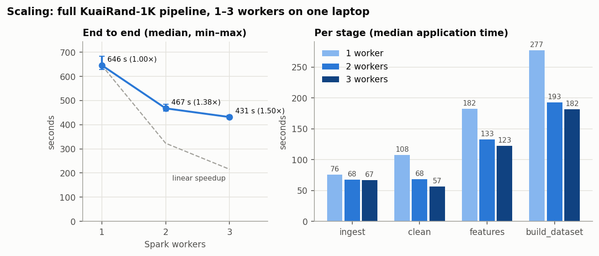
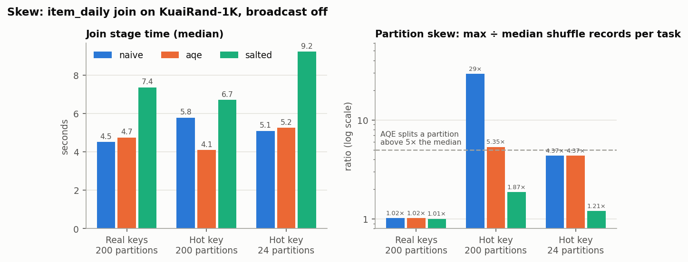
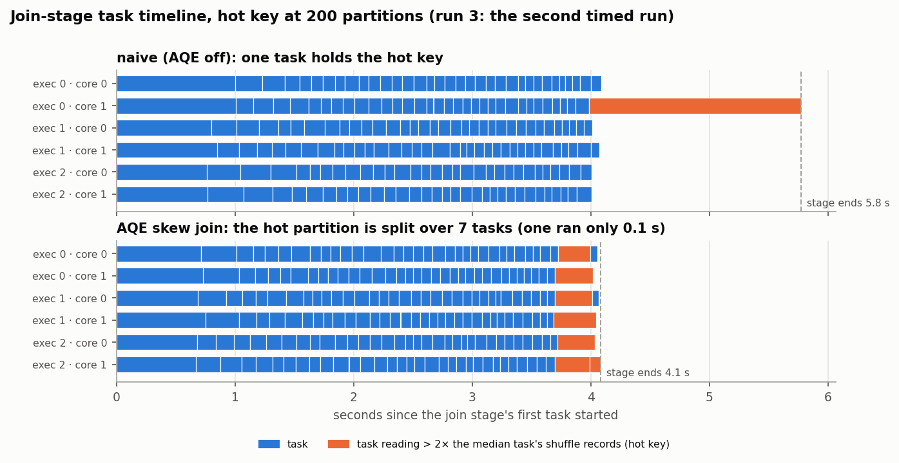
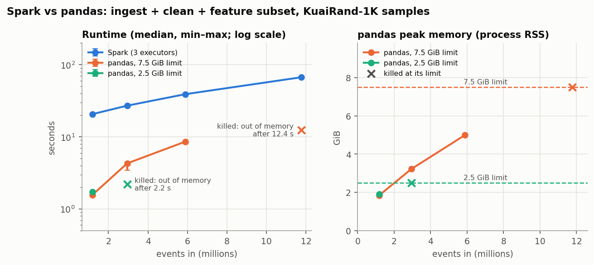
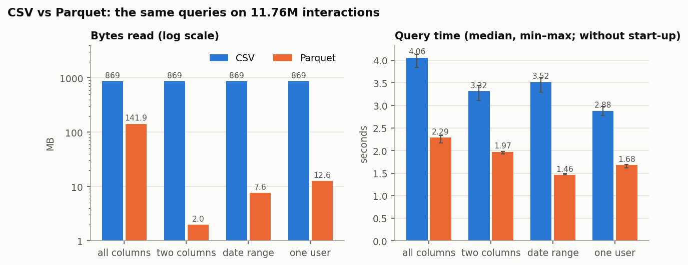
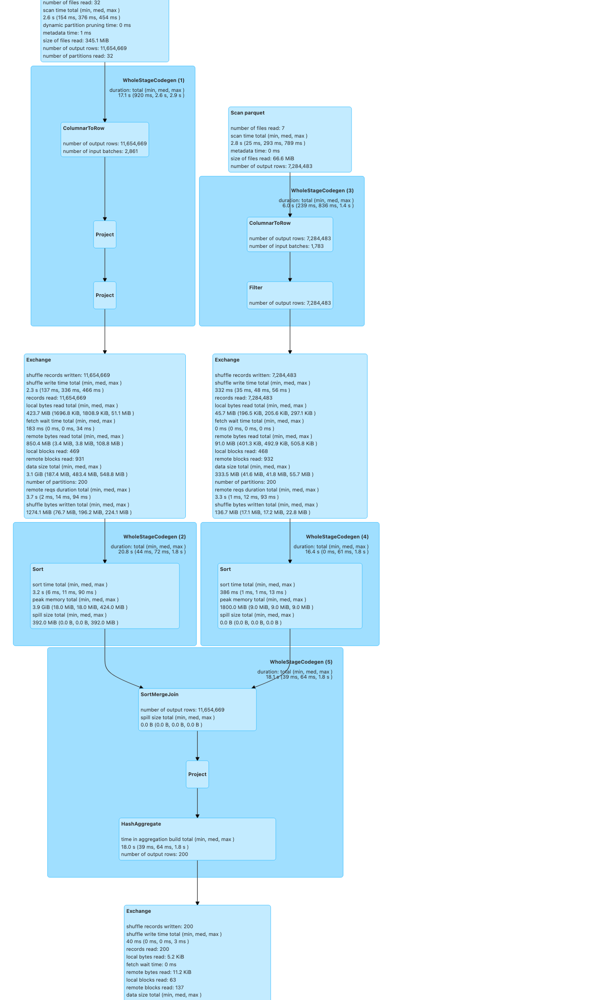
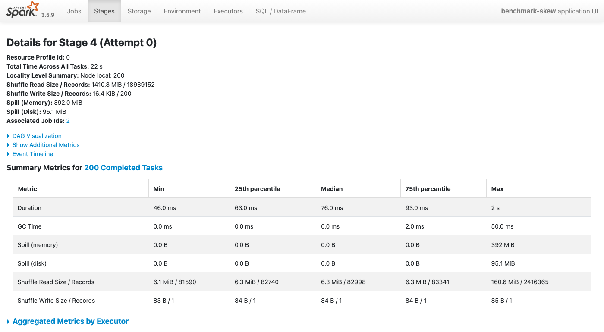
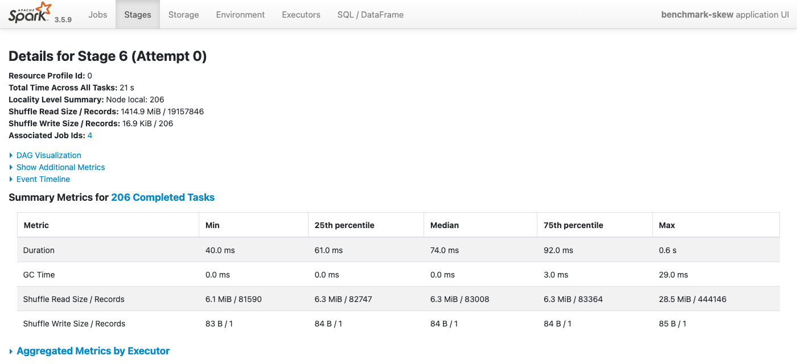

# spark-recsys-pipeline

A distributed data preprocessing pipeline that turns raw short-video interaction logs into a training dataset for a recommendation model.

Raw logs land in **HDFS**, **Apache Spark** cleans them and builds features across a cluster of workers, and the result is written back as partitioned **Parquet**. A **PyTorch** CTR model then trains on that data.

> **Status:** Phases 0–6 cover the implemented raw-to-gold pipeline, training, model verification, and engineering benchmarks. The corrected randomized-target control passes; the original failed diagnostic remains documented (see Results). **[Phase 7: AWS recommendation platform](docs/phase-7/README.md)** is in progress: checkpoints 7.1–7.3 implement [contracts and synthetic fixtures](contracts/README.md), the [local foundation](docs/phase-7/completions/7.2.md), and [identity, project isolation, and scoped credentials](docs/phase-7/completions/7.3.md). Customer data flows and cloud deployment remain planned. Build locally before one small recorded AWS deployment and teardown. Up to $100 in reported AWS credits is available; aim to spend comfortably below that maximum.

---

## Table of contents

1. [What we are building](#1-what-we-are-building)
2. [Why](#2-why)
3. [Key concepts](#3-key-concepts)
4. [Architecture](#4-architecture)
5. [Tech stack: what, where, and why](#5-tech-stack-what-where-and-why)
6. [Cluster configuration](#6-cluster-configuration)
7. [Data model](#7-data-model)
8. [How: pipeline stages](#8-how-pipeline-stages)
9. [Feature catalog](#9-feature-catalog)
10. [Data-quality checks](#10-data-quality-checks)
11. [Model training](#11-model-training)
12. [Engineering decisions](#12-engineering-decisions)
13. [Benchmark methodology](#13-benchmark-methodology)
14. [When: roadmap](#14-when-roadmap)
15. [Risks and mitigations](#15-risks-and-mitigations)
16. [Repository layout](#16-repository-layout)
17. [Running locally](#17-running-locally)
18. [Results](#18-results)

---

## 1. What we are building

The pipeline does four things end to end:

- **Stores** raw user–video interaction logs in a distributed file system (HDFS).
- **Processes** them in parallel with Spark: validation, cleaning, feature engineering, aggregation and a time-based train/val/test split.
- **Produces** a model-ready training dataset in Parquet, partitioned by date.
- **Trains** a click-through-rate (CTR) model (DeepFM) in PyTorch on that dataset, and reports AUC and log loss.

The whole cluster (HDFS and Spark) runs locally with Docker Compose so the research pipeline can be reproduced on a laptop. A hosted service additionally needs identity, isolated project data, online ranking, durable jobs, deployment, and operations; those are planned in [Phase 7](docs/phase-7/README.md).

### The ML task

> Given a user, a video, and the context of the moment (time, recent activity), predict the probability that the user **clicks** the video.

This is the core ranking problem behind short-video feeds and ad systems. A secondary label, **long view** (the user watched a large fraction of the video), can be swapped in with a config change.

### Dataset

[**KuaiRand**](https://kuairand.com/) is the primary dataset. It contains real interaction logs from Kuaishou, a short-video platform, including watch time, clicks, likes, follows and timestamps, plus user and video metadata. It fits the problem because:

- It is real feed-recommendation data, not synthetic.
- It comes in several sizes (`KuaiRand-Pure`, `KuaiRand-1K`, `KuaiRand-27K`). We develop on the small version and run benchmarks on the largest.
- The largest version is big enough that single-machine pandas becomes slow or runs out of memory, so Spark is justified.
- It has timestamps, so we can build sequential "user history" features and a leakage-free time split.

[KuaiRec](https://kuaisou.github.io/KuaiRec/) is a smaller fallback for fast iteration during development.

---

## 2. Why

Recommendation systems at scale depend less on model architecture than on the **data pipeline** that feeds them. Raw logs are huge, noisy and skewed: a few popular videos get most of the interactions. They have to be turned into correct, leakage-free features before any model sees them.

This project shows how to do that work at scale:

| Problem at scale | How this project addresses it |
|---|---|
| Data does not fit on one machine | HDFS for storage, Spark for parallel compute |
| Slow full-table scans | Columnar Parquet, partitioned by date |
| Hot keys (viral videos) stall joins | Key salting and broadcast joins |
| Features accidentally use future data | Window functions bounded to past events, time-based split |
| Silent data corruption between stages | Schema and data-quality checks after each stage |
| Re-running everything after one bug | Persisted bronze/silver/gold layers; each stage re-runs on its own |
| "Does it actually scale?" | Benchmarks with 1, 2 and 3 workers, compared to a pandas baseline |

---

## 3. Key concepts

A short primer on the ideas the rest of this README relies on.

### HDFS

- **NameNode**: stores the file system metadata, that is, which files exist and which blocks make up each file. It holds no file data itself.
- **DataNode**: stores the actual blocks on its local disk. Our cluster has two.
- **Block**: files are split into fixed-size blocks (128 MB by default) spread across DataNodes.
- **Replication**: each block is copied to several DataNodes (the default is 3; we use 2 because we only have two DataNodes). If one node dies, the data is still readable.
- **Data locality**: Spark prefers to schedule a task on the node that already holds the block it reads, so data does not cross the network. (In our Docker setup, Spark workers and DataNodes are separate containers, so every read goes over the Docker network. See [section 6](#6-cluster-configuration).)

### Spark

- **Driver**: the process that runs our PySpark script, builds the execution plan and schedules work.
- **Executor**: a process on a worker that runs tasks and caches data. Each worker in our cluster runs one executor.
- **Partition**: a chunk of a DataFrame. One partition is processed by one task on one core.
- **Lazy evaluation**: transformations (`filter`, `join`, `groupBy`) only build a plan. Nothing runs until an action (`write`, `count`) is called. This lets the Catalyst optimizer rewrite the whole plan first.
- **Narrow vs. wide transformations**:
  - Narrow (`filter`, `select`, `withColumn`) work within a partition and need no data movement.
  - Wide (`groupBy`, `join`, `window` with `partitionBy`) need a **shuffle**, which redistributes rows across the network by key. Shuffles are the main cost in most Spark jobs, so much of this project is about reducing or balancing them.
- **Job → stage → task**: each action creates a job, the job is split into stages at shuffle boundaries, and each stage runs one task per partition.
- **Skew**: when one key has far more rows than others, the task handling that key runs much longer than the rest, and the whole stage waits for it.
- **AQE (Adaptive Query Execution)**: Spark 3 feature that re-optimizes the plan at runtime using real statistics. It merges small shuffle partitions, splits skewed ones, and switches join strategies.

### Medallion layers

| Layer | Content | Purpose |
|---|---|---|
| **raw** | Original CSVs, untouched | Source of truth; can always re-run from here |
| **bronze** | Same data, typed and in Parquet | Fast, schema-enforced reads |
| **silver** | Cleaned and deduplicated | Trusted base for feature engineering |
| **gold** | Features joined and split | Directly consumable by model training |

---

## 4. Architecture

```
            Raw interaction logs (CSV)
                        │
                        ▼
      ┌─────────────────────────────────────┐
      │ HDFS                                │
      │ namenode + 2 datanodes              │
      │ /raw   /bronze   /silver   /gold    │
      └─────────────────────────────────────┘
                        │
                        ▼
      ┌─────────────────────────────────────┐
      │ Spark standalone cluster            │
      │ master + 3 workers                  │
      │                                     │
      │ Worker 1 ─► partitions 1..k         │
      │ Worker 2 ─► partitions k+1..2k      │
      │ Worker 3 ─► partitions 2k+1..n      │
      └─────────────────────────────────────┘
                        │
    1. Ingest       raw CSV    → bronze (typed Parquet)
    2. Clean        bronze     → silver (deduped, filtered)
    3. Features     silver     → user / item / context features
    4. Aggregate    join all features → one row per interaction
    5. Split        time-based train / val / test → gold
       (quality checks run after every stage)
                        │
                        ▼
      Gold Parquet dataset on HDFS
                        │
                        ▼
      PyTorch DataLoader → DeepFM → AUC, log loss
```

### How a stage executes

Taking the feature stage as an example:

1. `spark-submit` starts the **driver**, which connects to the Spark master.
2. The master assigns **executors** on the three workers.
3. The driver reads the silver Parquet metadata from the NameNode and plans one task per input split.
4. Executors read blocks directly from the DataNodes (on a real cluster, preferring blocks stored on their own node).
5. Narrow operations (filters, derived columns) run in place. A `groupBy user_id` triggers a shuffle, so rows with the same user end up in the same partition.
6. Results are written back to HDFS as Parquet, one file per output partition.

---

## 5. Tech stack: what, where, and why

| Layer | Technology | Where it is used | Why this choice |
|---|---|---|---|
| Storage | **HDFS** (Hadoop 3.3.6) | Holds the raw, bronze, silver and gold datasets | Distributed and fault-tolerant, and data locality lets Spark read blocks on the node where they are stored. It is the standard storage layer in the Hadoop ecosystem. |
| Compute | **Apache Spark 3.5.9** (PySpark) | Every pipeline stage in `pipeline/` | In-memory distributed processing, the Catalyst query optimizer, and the DataFrame API. AQE helps with skew and shuffle sizing. |
| File format | **Apache Parquet** (Snappy compression) | Every layer after raw | Columnar storage with compression, predicate pushdown and column pruning. It is much faster to scan than CSV and stores the schema with the data. |
| Cluster runtime | **Docker Compose** | `docker-compose.yml` | Runs the multi-node HDFS and Spark cluster on one laptop. Reproducible, and nothing to install beyond Docker. |
| Language | **Python 3.10** | Pipeline, training and tooling | One language from ETL through to model training. 3.10 is what the official Spark image ships, and the driver and executors must run the same Python version. |
| ML training | **PyTorch 2.x** | `training/` | Industry standard for recommendation models, and it has a flexible `Dataset` and `DataLoader` for streaming Parquet. |
| Parquet → tensors | **PyArrow** | `training/dataset.py` | Reads Parquet shards efficiently without going through pandas. |
| Metrics | **scikit-learn** | `training/` | Standard AUC and log-loss implementations. |
| Data quality | Custom PySpark checks | `pipeline/quality_checks.py` | Lightweight assertions on schema, null rates, row counts and value ranges, with no extra framework. |
| Configuration | **YAML** config file | `config/pipeline.yaml` | Paths, thresholds and label choice live in one place instead of being hard-coded. |
| Testing | **pytest** with a local `SparkSession` | `tests/` | Unit tests for each transformation on small hand-built DataFrames. |
| Benchmarks and plots | **pandas**, **matplotlib** | `benchmarks/` | Single-machine baseline for comparison, and plots of scaling results. |
| Monitoring | **Spark UI** and History Server | During development | Inspect stages, shuffles, skew and task timelines. Screenshots go in this README. |

**Considered and not used (for now):**

- **YARN** as the resource manager: Spark standalone mode is simpler to run in Docker and teaches the same partitioning and shuffle concepts. YARN is a possible stretch goal.
- **Hive / Delta Lake**: plain partitioned Parquet keeps the focus on Spark itself. Delta Lake is a possible extension for ACID writes and time travel.
- **Airflow**: stages are run by a simple driver script first. Orchestration can come later.
- **Spark MLlib for training**: MLlib does not support deep CTR models like DeepFM. Spark handles data, PyTorch handles the model, which is how most production systems split the work.

---

## 6. Cluster configuration

Sized to fit a laptop with 16 GB of RAM, with about 11 GB given to Docker. Built and verified in phase 1 on an Apple Silicon Mac with [OrbStack](https://orbstack.dev/).

**Images**
- **Hadoop:** the official `apache/hadoop` images are amd64-only, so `docker/hadoop/Dockerfile` builds our own from the Apache 3.3.6 release tarball (the aarch64 or x86 build, picked automatically and checked against its SHA-512) on `eclipse-temurin:11-jre`. Hadoop 3.3 supports Java 8 and 11 at runtime.
- **Spark:** `docker/spark/Dockerfile` is a thin layer over the official multi-arch `apache/spark:3.5.9-java17-python3` (Python 3.10). It adds `spark-defaults.conf`, the pipeline's Python dependencies (plus pandas and pyarrow for the pandas baseline benchmark, which runs in its own container from this image), and an event-log directory.

All host ports bind to `127.0.0.1`. HDFS and Spark run without authentication here, so they are not reachable from the local network.

### Containers

| Service | Image base | Role | Resources | Ports |
|---|---|---|---|---|
| `namenode` | Hadoop 3.3.6 (own build) | HDFS metadata | 1 GB | 9870 (UI), 9000 (RPC) |
| `datanode-1`, `datanode-2` | Hadoop 3.3.6 (own build) | HDFS block storage | 1 GB each | 9864, 9865 (UI) |
| `spark-master` | Spark 3.5.9 | Cluster manager; also runs the driver of jobs submitted from it | 1.5 GB | 8080 (UI), 7077 (RPC), 4040 (app UI) |
| `spark-worker-1..3` | Spark 3.5.9 | One executor each (2 cores, 1 GB heap) | 2 cores, 2.5 GB each (worker + executor peaked at about 2.0 GiB on KuaiRand-1K) | 8081–8083 (UI) |
| `spark-history` | Spark 3.5.9 | History Server for finished jobs; keeps loaded apps in an on-disk store (`spark.history.store.path`) | 1 GB (768 MB heap) | 18080 (UI) |

**Data locality caveat:** Spark workers and DataNodes run in separate containers, so executors never find a block on their own "node" and every HDFS read crosses the Docker network. On one laptop this costs little, since the network is virtual. Co-locating a DataNode and a worker in one container is a possible later experiment.

### Key Spark settings

| Setting | Value | Why |
|---|---|---|
| `spark.sql.adaptive.enabled` | `true` | Enable AQE (turned off for the "naive" skew benchmark) |
| `spark.sql.adaptive.skewJoin.enabled` | `true` | Let AQE split skewed join partitions |
| `spark.sql.shuffle.partitions` | `24` initially | Default of 200 is too many for 6 cores; AQE coalesces further |
| `spark.sql.autoBroadcastJoinThreshold` | `10MB` (default) | Small tables broadcast automatically; we also broadcast explicitly where needed |
| `spark.serializer` | `KryoSerializer` | Faster and more compact than Java serialization |
| `spark.sql.windowExec.buffer.in.memory.threshold` | `131072` (default 4096) | Window functions buffer a user's whole history. Past the threshold they spill in many small files, and reading them back opens each with a 1 MB heap buffer; KuaiRand-1K's largest user (127K events) ran executors out of heap. Changes memory use only, not results |
| `spark.eventLog.enabled` | `true` | Needed for the History Server and benchmark evidence |
| `spark.history.store.path` | `/opt/spark/history-store` | The History Server keeps loaded applications on disk instead of in its heap. With the in-memory default and a 384 MB heap, it ran out of memory partway through the scaling benchmark |
| `dfs.replication` (HDFS) | `2` | Matches the number of DataNodes. Also set as `spark.hadoop.dfs.replication`, because Spark's HDFS client does not read the cluster's `hdfs-site.xml` and would otherwise write files with 3 replicas |

### HDFS directory layout

```
hdfs:///
├── raw/kuairand/                  # original CSVs
├── bronze/interactions/event_date=YYYYMMDD/   # standard + random logs (is_rand)
├── bronze/users/  bronze/videos/  bronze/video_stats/
├── silver/interactions/event_date=YYYYMMDD/
├── silver/users/  silver/videos/
├── features/events/event_date=YYYYMMDD/       # one row per event: labels, history, context, cross
├── features/item_daily/  features/author_daily/   # previous-day stats per (key, date)
├── features/user_static/  features/video_static/  # encoded dimension tables
├── gold/train/  gold/val/  gold/test/  gold/test_random/   # model-ready, shuffled, fixed file count
└── gold/_metadata/                # feature_spec.json, scaling_stats.json, vocab/<name>/,
                                   # vocab_sizes.json, run_stats/<stage>.json
```

KuaiRand-1K (`config/pipeline-1k.yaml`) writes the same layers under `/1k/` (`/1k/bronze`, …, `/1k/gold`), so Pure and 1K live side by side; raw files are under `raw/kuairand/<version>/`.

---

## 7. Data model

KuaiRand is downloaded from [Zenodo](https://zenodo.org/records/10439422) (CC BY-SA 4.0) by `scripts/download_data.sh`. The columns below were confirmed against KuaiRand-Pure; `pipeline/schemas.py` will be the source of truth.

| File | Rows (Pure) | Content |
|---|---|---|
| `log_standard_4_08_to_4_21_pure.csv`, `log_standard_4_22_to_5_08_pure.csv` | 1.14M + 0.30M | Impressions served by the recommender. **Training source.** |
| `log_random_4_22_to_5_08_pure.csv` | 1.19M | Videos inserted at random (`is_rand = 1`). Different exposure distribution, kept as an optional unbiased evaluation set. |
| `user_features_pure.csv` | 27,285 | One row per user |
| `video_features_basic_pure.csv` | 7,583 | One row per video |
| `video_features_statistic_pure.csv` | 7,583 | One row per video, monthly averages. **Not used** (see below). |

Facts observed in Pure:
- Standard logs cover **2022-04-09 to 2022-05-08** (30 days). Volume is front-loaded: April 10–12 are the busiest days.
- `is_click` positive rate is about **46%**, much higher than typical ad CTR, because an impression here is a video already shown in the feed. In the random log it is about 18%.
- **Time:** `time_ms` is the precise event time. `date` and `hourmin` are coarse: `hourmin` is always a whole hour, and the pair is logged up to about ±50 minutes away from `time_ms`, which puts 0.8% of rows on a different day. The pipeline therefore derives `event_date` and `event_hour` from `time_ms` (Beijing time) and uses only those.
- **Shared timestamps:** 6% of events share an exact `time_ms` with other videos from the same user, most likely because one feed request serves several videos. History features must treat these as simultaneous (see [stage 3](#stage-3-feature-engineering-pipelinefeaturespy)).

Full profile: `docker exec spark-master spark-submit /opt/project/scripts/profile_raw.py`.

### Interaction log (main fact table)

| Column | Type | Meaning |
|---|---|---|
| `user_id` | int | User identifier |
| `video_id` | int | Video identifier |
| `date` | int (YYYYMMDD) | Coarse logged date (kept, not used) |
| `hourmin` | int (HH00) | Coarse logged hour (kept, not used) |
| `time_ms` | long | Event timestamp in milliseconds: **the source of truth for time** |
| `event_ts`, `event_date`, `event_hour` | timestamp, int, int | Derived from `time_ms` in Beijing time during ingest. `event_date` is the partition column. |
| `is_click` | int (0/1) | User clicked the video (**primary label**) |
| `is_like`, `is_follow`, `is_comment`, `is_forward`, `is_hate` | int (0/1) | Other feedback signals |
| `long_view` | int (0/1) | User watched a long portion (**alternative label**) |
| `play_time_ms` | long | Time spent watching |
| `duration_ms` | long | Video length. Null in silver when unknown (recorded as 0 for 237 videos). |
| `profile_stay_time`, `comment_stay_time` | long | Time spent on the author profile / comments |
| `is_profile_enter` | int (0/1) | User opened the author's profile |
| `tab` | int | Which app tab the event happened on |
| `is_rand` | int (0/1) | Whether the video was shown randomly (not by the recommender) |

### Dimension tables

| Table | Grain | Example columns |
|---|---|---|
| User features | one row per user | `user_active_degree` (string), `is_live_streamer`, `is_video_author`, follow/fans/friend counts and range buckets (quoted strings like `"[100,1k)"`), `register_days`, `onehot_feat0..17` |
| Video basic features | one row per video | `author_id`, `video_type`, `upload_dt` (`YYYY-MM-DD`), `upload_type`, `video_duration`, `music_id`, `tag` (numbers stored as floats) |
| Video statistics | one row per video | ~50 show/play/like/comment/share counts, each an **average of daily values over the whole month** |

**Why video statistics are not used:** each value averages the full month, including the val and test days, so using it as a feature would leak future information. Item statistics are instead computed from the interaction logs per (`video_id`, `date`), using previous days only. That self-built table is the skewed large-to-large join in stage 4.

### Output (gold) schema

One row per interaction, 74 columns. `gold/_metadata/feature_spec.json` lists every column by role, so training code reads the spec instead of hard-coding names:

```
label              : int         # is_click (or long_view, set by `label` in config)
user_id, video_id, time_ms       # event key, kept for traceability; not features
37 categorical     : int         # user_idx, video_idx, author_idx, music_idx, tab_idx,
                                 # hour_of_day, day_of_week, video/user categorical *_idx
22 numeric         : float       # log1p where heavy-tailed, standardized with train stats
9 <col>_missing    : int         # 1 where the numeric had no information yet
hist_video_idx     : array<int>  # last 20 viewed videos, left-padded with 0
event_date         : int         # for analysis; not a feature
```

Every vocabulary uses the same index layout: `0` = padding, `1` = unknown (rare, unseen, or null), `2..` = known values, most frequent first.

---

## 8. How: pipeline stages

Each stage is a standalone PySpark script that reads one layer and writes the next. `scripts/run_pipeline.sh` runs them in order with `spark-submit`.

### Stage 1. Ingest: `pipeline/ingest.py`

**Input:** `hdfs:///raw/` · **Output:** `hdfs:///bronze/`

- Upload raw CSVs to HDFS with `scripts/load_to_hdfs.sh` (`hdfs dfs -put`).
- Read with an **explicit schema** from `schemas.py` in `FAILFAST` mode, so a malformed row stops the job instead of silently becoming nulls. `inferSchema` needs an extra full pass over the data and guesses wrongly here: several ID columns are written as floats (`9.0`).
- Cast types and derive `event_ts`, `event_date` and `event_hour` from `time_ms` in Beijing time.
- Standard and random logs go into **one interactions table**, told apart by `is_rand`. They never share an event, and the bot check needs each user's full activity.
- Write Parquet **partitioned by `event_date`**, so later stages that need a date range only read those directories (partition pruning). Each date is one file, sorted by user and time.
- Ingest adds and removes no rows: a quality check compares bronze and raw row counts.
- Record row counts in `gold/_metadata/run_stats/ingest.json`.

### Stage 2. Clean: `pipeline/clean.py`

**Input:** `bronze` · **Output:** `silver`

The rules were set after profiling the raw data (`scripts/profile_raw.py`). Counts are for KuaiRand-Pure, standard and random logs together (2,622,668 rows).

| Rule | Evidence | Effect in Pure |
|---|---|---|
| Drop rows with null `user_id`, `video_id` or `time_ms` | None found; kept as a guard | 0 removed |
| Collapse duplicate events (same `user_id`, `video_id`, `time_ms`) into one row, taking the **max** of each outcome column | 1.6% of standard-log events are logged 2–6 times. Copies differ mostly in the coarse hour; about 20 later copies carry more engagement (e.g. a click), so the max keeps the most complete record | 23,483 removed |
| Drop rows with negative `play_time_ms` or `duration_ms` | None found; kept as a guard | 0 removed |
| Drop impressions of videos with no `upload_dt` | Video age is undefined without it. None in Pure; 58 videos in KuaiRand-1K (183 of 11.76M events) | 0 removed |
| Treat `duration_ms = 0` as **unknown (null)** and keep the row | 237 videos have no recorded length anywhere (log or video table), but their impressions are real: 82% have play time, 23% are clicked. Dropping them would remove 2% of data and bias against those videos | 65,779 changed |
| Cap `play_time_ms` at 5× `duration_ms` | Watch-ratio p99.9 is 4.94, max 68 (looping videos) | 1,923 changed |
| Drop **bot-like user-days**: ≥ 20 feed requests (distinct timestamps) with a median gap under 2 s between them, or more than 16 h of play | The originally planned rule (users above the 99.9th percentile of daily events) would have removed 5.4% of rows. The heaviest user-days (up to 237 events) are fast scrollers with 15 s+ median gaps and under 1 h of play, not bots. Gaps are measured between requests because a request's videos share one timestamp: KuaiRand-1K serves ~6 per request, so 83% of event gaps are 0 s and a per-event rule flagged 99.7% of its rows | 0 removed |
| Dimension tables: missing strings → `UNKNOWN`, missing integer codes → `-1`, `tag` → `tags` (array of ints) | Nulls in 7 `onehot_feat` columns, `music_type`, `tag`; `tag` holds lists like `"12,60"` | No rows removed |

Every rule logs how many rows it removed or changed (`gold/_metadata/run_stats/clean.json`), so over-aggressive cleaning is visible. In total, cleaning removed **0.90%** of interactions.

`watch_ratio` is not stored in silver. It is a derived feature, computed in stage 3; storing it would add about 8 bytes of incompressible doubles per row (+33% silver size in Pure).

### Stage 3. Feature engineering: `pipeline/features.py`

**Input:** `silver` · **Output:** `features/`

Feature tables are built separately and joined in stage 4. The full list is in the [feature catalog](#9-feature-catalog).

| Output | Grain | Content |
|---|---|---|
| `features/events` | one row per event | Labels, user history, context and user × author features. Partitioned by `event_date` |
| `features/item_daily`, `features/author_daily` | (video or author, date) | Impressions, smoothed click rate and watch ratio over **previous days** |
| `features/user_static`, `features/video_static` | one row per user / video | IDs and categorical columns encoded to indices, plus raw numerics |
| `gold/_metadata/vocab/<name>/`, `vocab_sizes.json` | — | The encodings and embedding-table sizes |

Key techniques:
- **Window functions** for per-user history, with frames that end *strictly before* the current event's timestamp:
  ```python
  w = (Window.partitionBy("user_id")
             .orderBy("time_ms")
             .rangeBetween(Window.unboundedPreceding, -1))
  df = df.withColumn("user_hist_ctr", F.avg("is_click").over(w))
  ```
  A row-based frame (`rowsBetween(..., -1)`) would leak: 6% of events share a timestamp with other videos from the same feed request, and a row frame lets one of them see its siblings' clicks. A range frame on `time_ms` excludes everything at the same moment.
- **One shuffle for every user window.** The events are repartitioned by `user_id` once. The history, session (`user_id`, session) and user × author (`user_id`, `author_id`) windows all reuse that partitioning, because data clustered by `user_id` is also clustered by any key that includes it. The stage records the number of `user_id` shuffles in its physical plan (`run_stats/features.json`): **1**.
- **History list without an unbounded window.** `collect_list` over an unbounded frame would build a list as long as the user's whole history for every event. Instead the window looks back N + 10 rows, drops events at the current timestamp, and keeps the last N. Same-timestamp groups are at most 6 events in Pure, so 10 rows of slack is enough. The history is the last N *viewed* (shown) videos, not only clicked ones.
- **Sessions:** a new session starts after a 30-minute gap. Events at the same timestamp share a session and a position.
- **Point-in-time item and author statistics:** cumulative stats over days before the event date, never the same or later days. Click rates are smoothed toward the global click rate of *previous days*: `(clicks + 20 × prior) / (impressions + 20)`. A brand-new video gets exactly the prior instead of a noisy 0/0 or 1/1.
- **Categorical encoding:**
  - **ID features** (user, video, author, music) and `tab`: vocabularies are built from **training-period events only**. Values seen fewer than `min_count` (5) times there map to the shared unknown index. In Pure, 11,458 val/test events come from users never seen in training, and they get the unknown index, as a cold-start user would in production.
  - **Static categorical columns** (user activity level, follower buckets, the 18 anonymized `onehot_feat` columns, video type, primary tag): vocabularies are built from the dimension table itself. Rare values (`min_count`) map to unknown.
  - All vocabularies are written to HDFS and read back before use. An early version built each one from the table as encoded so far, which nested every previous join into the next query plan. The plan doubled with each of the 22 user columns, and the driver ran out of memory.
- **Numeric scaling moves to stage 4.** `log1p` and standardization need statistics from the *joined training rows*, and those only exist after the stage 4 join. Stage 3 therefore stores raw numerics.

**Sanity check: single-feature AUC on the standard log.** If any single feature predicts the click almost perfectly, that is a strong sign of leakage. None does:

| Feature | AUC alone | Null % |
|---|---|---|
| `user_hist_ctr` | 0.696 | 2.0 (first events) |
| `user_hist_avg_watch_ratio` | 0.679 | 2.0 |
| `video_ctr_prev` | 0.652 | 3.8 (first day of data) |
| `author_ctr_prev` | 0.651 | 3.8 |
| `video_avg_watch_ratio_prev` | 0.595 | 19.0 (each video's first day; unknown durations) |
| Others | 0.44–0.55 | 0 |

The nulls are real "no information yet" cases. Stage 4 fills them and adds missing-value indicators.

### Stage 4. Aggregate and join: `pipeline/build_dataset.py`

**Input:** `features/` · **Output:** a joined DataFrame (in memory)

- Start from `features/events` (one row per interaction, labels included).
- **Broadcast joins** with `user_static` and `video_static`: both are small enough to copy to every executor, so the event table is not shuffled.
- Join `item_daily` on (`video_id`, `event_date`) and `author_daily` on (`author_id`, `event_date`). How the `item_daily` join runs is configurable (`join.item_daily_strategy`): **broadcast** (default), **salted**, or plain **sortmerge**. All three give identical rows, both in unit tests and on the full Pure data (same checksum). Why broadcast is the default is in [skew handling](#skew-handling).
- Checks: no fan-out (2,599,185 rows in and out), unique event keys, and every event matched in all four tables.
- **Fill nulls and scale numerics** (moved here from stage 3, because the statistics need the joined training rows):
  - Statistics come from **training rows only** (standard log, training dates) and are saved to `gold/_metadata/scaling_stats.json`.
  - 13 heavy-tailed counts and durations get `log1p` (clipped at 0 first, so a negative count can never become −∞). Then every one of the 22 numerics is standardized: `(x − train mean) / train std`.
  - Nulls mean "no information yet" (first event, first day, unknown duration). They become the training mean, i.e. exactly 0 after scaling, and each of the 9 nullable columns gets a `<col>_missing` flag, so the model can tell "average" from "unknown".
  - Mean and std are rounded to 9 decimals, so last-bit noise in float sums cannot change the output between runs.
- Result: one row per interaction with all features and the label.

### Stage 5. Split and write gold: `pipeline/build_dataset.py`

**Output:** `hdfs:///gold/{train,val,test,test_random}/` and `gold/_metadata/feature_spec.json`

| Split | Source | Dates | Rows (Pure) | Click rate | Files |
|---|---|---|---|---|---|
| `train` | standard log | Apr 9 – Apr 29 | 1,262,136 | 46.6% | 8 |
| `val` | standard log | Apr 30 – May 3 | 78,444 | 46.2% | 2 |
| `test` | standard log | May 4 – May 8 | 72,556 | 44.5% | 2 |
| `test_random` | random log | May 4 – May 8 | 527,007 | 18.2% | 2 |

- **Time-based split.** A random split would put future events in training and past events in test, which inflates offline metrics and does not reflect how the model is used in production.
- **`test_random`** holds videos the app showed at random, not ones the recommender picked. Evaluating on it shows how well the model ranks *any* video, not just the ones the old recommender already favoured. Random-log rows on train and val dates (659,042) are not used, so training stays on the recommender's own distribution.
- **Shuffled, fixed-size files.** Rows are ordered by a seeded hash of the event key, so training batches are not time-ordered and row order is reproducible. Each split gets a fixed number of files (`gold.files`), so training readers are not slowed by many tiny files and DataLoader workers get even shares. (A first version reduced the hash to 8 values before repartitioning. Spark hashed those 8 values again, collisions left half the files empty, and train got 4 files instead of 8. A file-count check and a unit test now guard against this.)
- **`feature_spec.json`** lists every categorical column with its embedding size, the numerics, the flags, the history sequence, the label, and each split's dates and row count.

### Stage 6. Data-quality gates: `pipeline/quality_checks.py`

Called at the end of every stage. See [data-quality checks](#10-data-quality-checks). A failed check stops the pipeline with a clear message.

### Stage 7. Training: `training/`

See [model training](#11-model-training).

---

## 9. Feature catalog

| Group | Feature | Definition | Technique |
|---|---|---|---|
| **User** | `user_hist_cnt` | Number of the user's earlier events | Window count, range frame ending before this timestamp |
| | `user_hist_ctr`, `user_hist_like_rate` | Click and like rate over earlier events (null if none) | Window sums / count |
| | `user_hist_avg_watch_ratio` | Mean of `play_time / duration` over earlier events with a known duration | Window avg |
| | `hist_video_idx`, `hist_len` | Last 20 viewed videos (encoded, left-padded) and how many are real | `collect_list` over a bounded row frame, same-timestamp events filtered out |
| | `user_active_days` | Distinct active days before today | `dense_rank` of date − 1 |
| | user static features | Activity level, follower / fan / friend counts and buckets, registration age, 18 anonymized categoricals | `features/user_static`, joined in stage 4 |
| **Item** | `video_impr_prev`, `video_ctr_prev` | Video impressions and smoothed click rate over previous days | Daily aggregate + cumulative window ending at yesterday |
| | `video_avg_watch_ratio_prev` | Mean watch ratio over previous days | Same |
| | `author_ctr_prev` (+ impressions, watch ratio) | The same for the video's author | Same, by `author_id` |
| | `video_age_days` | Event date − upload date | Date arithmetic |
| | video static features | Video, author and music IDs, video type, upload type, music type, primary tag, duration | `features/video_static`, joined in stage 4 |
| **Context** | `hour_of_day`, `day_of_week` | From the event time / date (Beijing time) | Column expressions |
| | `secs_since_last_event` | Gap since the user's previous *timestamp* (siblings ignored) | Window max over the range frame |
| | `session_position` | Position in the current session (new session after a 30 min gap) | Running sum of session starts, then a window per session |
| | `tab_idx` | App tab | Encoded raw column |
| **Cross** | `user_author_prev_impr`, `user_author_prev_clicks` | How often this user saw / clicked this author before | Window partitioned by user and author |

## 10. Data-quality checks

| Check | Applied after | Rule (starting value) | On failure |
|---|---|---|---|
| Schema match | every stage | Column names and types equal the expected schema | Fail |
| Non-empty output | every stage | Row count > 0 | Fail |
| Row-count equality | ingest | Bronze rows = raw CSV rows (ingest only changes types) | Fail |
| Row-count drift | clean | Rows removed ≤ 10% of input | Fail |
| Primary-key uniqueness | clean | No duplicate (`user_id`, `video_id`, `time_ms`); dimension keys unique | Fail |
| No nulls in keys | clean | IDs, `time_ms`, `event_ts`, `event_date`, `play_time_ms` | Fail |
| Value ranges | clean | Watch ratio in [0, 5]; `is_click`, `long_view`, `is_rand` in {0, 1} | Fail |
| Join fan-out | features | Event features have exactly one row per silver event (the video join adds none) | Fail |
| Leakage: same-timestamp events | features | Events of one user at one timestamp have identical history features | Fail |
| Leakage: first events | features | Every user's first event has no history; every video's / author's first day has no previous-day stats | Fail |
| Value ranges | features | Rates within [0, 1]; history length within [0, N] and every list exactly N long; ages, gaps, positions positive | Fail |
| Static tables | features | One row per silver user / video; no null indices | Fail |
| Join fan-out and matches | build_dataset | Rows after all joins = event rows; event keys unique; every event matched in user, video, item-daily and author-daily tables | Fail |
| Scaling | build_dataset | No nulls or NaN/infinity in numerics; on training rows every scaled column has mean 0 and std ≤ 1 | Fail |
| Row accounting | gold | train + val + test = all standard-log rows; test_random = all random-log test rows | Fail |
| Split integrity | gold | max(train date) < min(val date), max(val date) < min(test date) | Fail |
| No nulls, same schema | gold | Every split, every column | Fail |
| Indices fit vocabularies | gold | Every categorical and history index < its embedding size | Fail |
| File count | gold | Each split has its configured number of files | Fail |
| Label balance | gold | Positive rate within the expected band (separate band for the random log) | Warn |

The join fan-out check catches a common and silent bug: a dimension table with duplicate keys multiplies rows during a join.

---

## 11. Model training

### Data loading

- `training/dataset.py` implements a PyTorch `IterableDataset` that reads gold Parquet files with PyArrow and yields whole batches (categorical indices, scaled numerics plus missing flags, the history sequence, the label). Column roles come from `gold/_metadata/feature_spec.json`, so no feature names are hard-coded.
- Files are sharded across `DataLoader` workers so each worker reads different files; tests check that every row is read exactly once with 0, 2, or more workers than files. With `shuffle=True`, file order and rows within each file are reshuffled every epoch, deterministically from (seed, epoch).
- Reading is fast enough that workers are not needed: about 2.4M rows/s in-process, so one training epoch (1.26M rows) is read in 0.5 s. On macOS each worker is a new process that re-imports PyTorch (3–5 s), so training defaults to `num_workers=0`.
- The gold data is copied from HDFS to local disk before training (`hdfs dfs -get`), which keeps the training code simple. Reading directly from HDFS through PyArrow is a stretch goal.

### Models

| Model | Purpose | Details |
|---|---|---|
| Logistic regression | Baseline | One-hot / embedding-sum of categorical features + numeric features |
| **DeepFM** | Main model | Shared embeddings feed two parts: a **factorization machine** that learns pairwise feature interactions, and an **MLP** that learns higher-order interactions. Outputs are summed and passed through a sigmoid. |

User history (`user_last_n_videos`) is included by mean-pooling the history video embeddings. Attention pooling (as in DIN) is a stretch goal.

`training/models.py` implements `LogisticRegression(spec)` and
`DeepFM(spec, embedding_dim=16, hidden_dims=(128, 64), dropout=0.0)`. Both accept
the loader's batch dictionary and return one **logit** per row (`[B]`); use
`BCEWithLogitsLoss` for training and `torch.sigmoid(logits)` for probabilities.
Dimensions and vocabulary sizes come from the feature spec. LR sums scalar
categorical weights, a numeric linear term (including missing flags), and a
mean-pooled history weight. DeepFM adds pairwise FM interactions and an MLP
using the same field embeddings in both paths. Each numeric value scales a
learned field vector. History has a separate embedding table from the target
video; PAD is excluded from its sum and count, with empty histories mapped to
zero. Ordinary categorical index zero remains learnable (for example, hour 0).

Model tests check the LR score, FM formula, and complete DeepFM score against
independent calculations, padding invariance, gradient flow, and fitting a small
batch to loss below 0.02.
Full model results and the control-method correction are recorded in
[Results](#18-results).

### Training setup

- `training/train_deepfm.py --model {lr,deepfm}` trains on the host CPU with
  Adam and `BCEWithLogitsLoss`. Defaults live in `config/pipeline.yaml` under
  `training`; CLI arguments override them. Python, NumPy and PyTorch use the
  configured seed, and CPU deterministic algorithms are enabled.
- Every epoch reads train and evaluates validation AUC. A strict improvement
  saves the best checkpoint; `patience` consecutive epochs without improvement
  stop training. The saved best state is restored before final evaluation.
- Runs evaluate validation only by default. Use `--evaluate-test` for a final
  model run: it evaluates `test` and, when present in the spec, `test_random`
  once each after selection. Tune using validation only; smoke runs do not need
  access to either test directory.
- To evaluate an already selected run without retraining, use `--evaluate-only
  --run-dir <run>`. This uses the checkpoint's saved settings and checks its
  feature spec and selected epoch. Final evaluation requires a full run and
  rejects training overrides, previous test predictions, or an existing
  evaluation marker. A failed evaluation retains its marker for investigation;
  it cannot silently retry held-out data.
- `num_workers=0` is the default. When workers are requested, they are recreated
  each epoch so they receive the new shuffle epoch; this incurs macOS spawn
  overhead. Persistent workers would retain the loader's previous epoch state.
- Full runs check train/evaluation row counts against the spec. For smoke runs,
  `--max-train-batches` and `--max-eval-batches` limit work and mark the saved
  metrics as `partial_run`. These subset results are not final model results.

Each run writes to a new directory under `checkpoints/`, or to an empty directory
specified by `--run-dir`. Existing nonempty directories are rejected. Artifacts:

- `best.pt`: best model state, Adam state, epoch, validation metrics, effective
  model/training settings and feature spec. Load with
  `torch.load(path, map_location="cpu", weights_only=True)`.
- `metrics.json`: epoch history, best epoch, effective settings, feature-spec
  digest, full/subset status, global AUC/log loss and mean predicted probability
  versus click rate. Metrics aggregate all rows, including partial batches.
- `predictions/val.npz`: labels, float64 probabilities and logits from the best
  epoch; test prediction files are added only during explicit final evaluation. These are
  the exact predictions used for the reported metrics, allowing independent
  recomputation with scikit-learn.
- `heldout_evaluation.json`: exclusive final-evaluation marker, selected
  checkpoint SHA-256, evaluated splits and completion status. Both final
  evaluation commands share this guard.

### Metrics

- **AUC**: how well the model ranks clicked items above non-clicked ones. The main metric for ranking.
- **Log loss**: how well-calibrated the predicted probabilities are.

---

## 12. Engineering decisions

These are the parts of the project that go beyond "it runs." Each one will be backed by Spark UI evidence or a benchmark.

### Partitioning
- **On disk:** partitioned by `date`, so time-range reads skip whole directories.
- **In memory:** repartitioned by `user_id` before user-level window aggregations. Each user's events land in one partition and several window functions share a single shuffle.
- **Output files:** controlled file count per partition to avoid the "small files problem," where HDFS NameNode memory and read overhead grow with the number of files.

### Skew handling
Viral videos create hot keys in the (`video_id`, `event_date`) join. Measured in Pure before choosing a strategy:

- **Keys are very skewed:** the busiest (video, date) has 3,430 events against a median of 9 (about 380×), and the top 5 keys hold 0.6% of all events.
- **Partitions are not:** a 24-way shuffle by that key puts thousands of keys in each partition, and the busiest partition holds only 1.08× the median.
- **`item_daily` is 3 MB**, so a broadcast join needs no shuffle at all.

So the default is **broadcast**. Pure timings for the stage: broadcast 12 s, sort-merge 14 s, salted 18 s (salting copies `item_daily` 8× for no benefit here). Salting is kept, with an equivalence test, for when both sides are too big to broadcast, as with KuaiRand-27K.

| Approach | How it works |
|---|---|
| Naive join | Plain sort-merge join with AQE disabled. Expect one or a few very slow tasks when partitions are skewed. |
| AQE skew join | Spark detects oversized partitions at runtime and splits them. |
| Manual salting | Each event gets a salt `0..S-1` from a hash of its key (not `rand()`, so every run puts each row in the same bucket). The other side is replicated `S` times, once per salt value, and the join is on (key, salt). A hot key's load is spread over `S` partitions. |

KuaiRand-1K is just as balanced at the partition level. Its busiest (video, date) key has 382 of 11.65M events, and over 24 partitions the busiest partition is 1.01× the median for that join, 1.01× for (author, date) and 1.34× for `user_id` (1,000 users, the largest with 127K events). So the phase 6 benchmark (section 18) also uses a constructed hot key: 20% of events moved onto one (video, date), with broadcast disabled.

### Broadcast joins
Small tables (user and video features, `item_daily` in Pure, vocabularies, per-date global click rates) are broadcast to every executor with `F.broadcast(...)`, so the large event table is not shuffled for those joins. In KuaiRand-1K, `video_static` (4.4M videos) and `item_daily` (67 MB of Parquet) are too large to broadcast from the 768 MB driver, so its config shuffle-joins both (`join.broadcast_video_static: false`, `join.item_daily_strategy: sortmerge`).

### Caching
DataFrames reused by several feature builders (the cleaned interaction table) are `persist()`-ed and `unpersist()`-ed when no longer needed, to avoid recomputing them from HDFS.

### Leakage prevention
- Window frames end strictly before the current event's timestamp (`rangeBetween`), so events from the same feed request never see each other. A unit test checks this, and it fails if the frame is switched to `rowsBetween` (verified by making that change).
- Item statistics use previous days only.
- Vocabularies and scaling statistics come from the training period only.
- Train/val/test split is by time.

### Reproducibility
- All paths, thresholds and seeds live in `config/pipeline.yaml`.
- **Same input, same feature values.** Rebuilding silver and features from scratch gives identical values in every column (checked with per-column checksums across 3 rebuilds). This needed one fix: after a shuffle, Spark does not fix the order of rows that tie in a window's sort key (same-timestamp events), and floating-point addition depends on order. Averages of watch ratios therefore differed in the last bits between rebuilds. They are now summed as exact decimals and converted to doubles only at the end. Integer sums and counts were already exact. Vocabulary ties are broken by value, and history lists are ordered by (`time_ms`, `video_id`), so both are deterministic too.
- Gold values and row order are identical across runs. Two full rebuilds were compared across all 1,940,143 gold rows and 74 columns, including vocabularies and deterministic JSON metadata. Scaling statistics are rounded to 9 decimals, and the training shuffle is a seeded hash, not `rand()`. Whole-file checksums can differ: the 14 Parquet shards had identical data bodies, but encoding lists in their footers appeared in different orders. Compare decoded values and row order for reproducibility; physical file bytes are not guaranteed to match. Run-stat timings also vary.
- Every stage writes its stats (row counts, timings, and a 12-character hash of the full config) to `gold/_metadata/run_stats/<stage>.json`, so any output can be traced to the settings that produced it.

---

## 13. Benchmark methodology

| Benchmark | What varies | What stays fixed | Measured |
|---|---|---|---|
| **Scaling** | 1, 2, 3 workers | Data, config, cores per worker | End-to-end runtime and per-stage runtime |
| **Skew** | Naive vs. AQE vs. salting | Everything else | Join stage time, max and median task time |
| **Spark vs. pandas** | Engine; data size (10%, 25%, 50%, 100%) | Same transformations | Runtime and peak memory; where pandas fails |
| **File format** | CSV vs. Parquet input | Same query | Scan time and bytes read |

Rules:
- Each configuration runs **3 times**, and we report the median.
- The first run after cluster start is discarded (warm-up).
- Results are saved as CSVs in `benchmarks/results/`. `benchmarks/plots.py` draws every plot from those CSVs alone (a rerun writes byte-identical PNGs), and `benchmarks/check_readme.py` checks every cell of the benchmark tables in section 18 against them; prose numbers are not checked.
- Because everything runs on one laptop, scaling results show the effect of parallelism, not true multi-machine network cost. This limitation is stated alongside the results.

### Harness

`benchmarks/common.py` runs a job (usually a `spark-submit` on the cluster) warm-up + N times and times each run end to end. A run's Spark applications are the ones the master lists as newly completed, so the cluster must be otherwise idle (the harness refuses to start if another app is running). For each application it reads stage times, task counts, max and median task time (Spark's nearest-rank quantiles) and input/shuffle bytes from the History Server REST API. Results go to `benchmarks/results/<benchmark>_{runs,stages,summary}.csv`; every run row carries the variant's full config and its hash, so like-for-like comparisons can be checked. `benchmarks/dummy_job.py` is a small cluster job for testing the harness.

`benchmarks/scaling.py` runs the four pipeline stages (ingest to build_dataset) on `config/pipeline-1k.yaml` with 1, 2 and 3 workers. It stops and starts worker containers with Docker and waits until the master shows exactly that many alive workers. Every application in a run must report that many executors in the History Server, so a worker that failed to join cannot pass as a smaller cluster. After each worker count, `benchmarks/output_checksum.py` computes row counts and an order-independent value checksum (sum of `xxhash64` over all columns) of silver interactions and every gold split; all counts must match. All three workers are started again when it ends, even after a failure. A full run (3 counts × 4 runs) takes about 1 hour 45 minutes.

`benchmarks/skew.py` runs `benchmarks/skew_job.py`, the pipeline's own `join_item_daily` on 1K's `features/events` and `features/item_daily` with broadcast disabled, in three variants that differ only in skew handling: **naive** (sort-merge, AQE off), **aqe** (sort-merge, AQE skew-join splitting on, partition coalescing off so it is the only change) and **salted** (the pipeline's salted join, 8 buckets, AQE off). Three scenarios fix the data and shuffle partitions: the real keys at 200 partitions, a constructed hot key (20% of events, picked by a hash so the same rows every run, moved onto the busiest real key, video 160718 on 2022-05-06) at 200 partitions, and the same hot key at the pipeline's 24. AQE's skew size threshold is lowered from 256 MB to 32 MB (advisory partition size 16 MB) to fit partitions of this size; its 5× factor is the default. Each run checksums the join output, and all runs in a scenario must match. Partition skew is read from Spark itself: the join stage's max and median shuffle records read per task. A full run takes about 15 minutes.

`benchmarks/pandas_baseline.py` runs one workload in both engines: ingest the raw 1K logs, apply the six clean rules, and build user history counts (`user_hist_cnt`, `user_hist_ctr`, `secs_since_last_event`, `user_active_days`) and `item_daily`. `benchmarks/workload_spark.py` calls the pipeline's own functions on the cluster. `benchmarks/workload_pandas.py` reproduces them in pandas 2.2 (pyarrow CSV reader), following Spark's semantics where pandas defaults differ: null-dropping filters, truncating casts, range frames over same-timestamp events, and `percentile_approx`'s lower median. A Spark test (`tests/test_workload_pandas.py`) runs both on the same edge-case CSVs and requires identical rows. pandas runs in a container from the Spark image with 6 CPUs (the cluster's executor cores) and a hard memory limit without swap: 2.5 GiB (one worker's `mem_limit` of 2560m) or 7.5 GiB (all three workers' limits together). Peak memory is the process's maximum resident set size, in MiB. Each run's container is kept until the driver has read Docker's `State.OOMKilled`; a run is recorded as out of memory only when Docker reports it OOM-killed, and larger sizes are then skipped for that limit. Any other failure, including a SIGKILL (exit 137) that Docker did not attribute to memory, stops the benchmark. Data sizes are samples of whole users (seeded shuffle, nested), so each user's history stays complete. After each size, `benchmarks/compare_outputs.py` joins both engines' outputs on their keys on the cluster and requires every row and value to match (floats within 1e-9 relative). Times are wall clock from the host, including JVM or container start-up. A full run takes about 20 minutes.

`benchmarks/formats.py` runs four queries, each as its own Spark application (`benchmarks/format_job.py`), on the raw 1K log CSVs and on bronze Parquet; the two variants of a query differ only in the format read. Bronze holds the same rows as the CSVs plus three columns derived from `time_ms`, so the CSV side gets `event_date` from the same `ingest.to_bronze_interactions` and is read with the explicit raw schema (no inference). The queries each exercise a different Parquet feature: **all_columns** sums every raw column (nothing to skip, only encoding and compression differ), **two_columns** computes per-user impressions and clicks (column pruning), **date_range** aggregates the last 7 of 32 days (partition pruning on `event_date` directories), and **one_user** aggregates one median-sized user (row-group and page statistics on `user_id`; bronze is sorted by user within each date). Recorded per run: end-to-end time, the query's own time measured inside the job (the action only, without JVM and session start-up), and bytes and records read from the History Server. Each run's result checksum must match the other format's for the same query, and a Spark test runs every query on matching tiny CSV and partitioned Parquet data. A full run takes about 5 minutes.

### Benchmark dataset: KuaiRand-1K

Pure is too small to show scaling or skew effects, so the benchmarks use KuaiRand-1K: 1.1 GB compressed, 4.3 GB of CSVs (3.1 GB of it the unused video statistics file). It has 1,000 heavy users instead of 27,285, which changed several assumptions that held for Pure. Each was measured, and `config/pipeline-1k.yaml` overrides only these keys of `pipeline.yaml`:

| | Pure | 1K | Change |
|---|---|---|---|
| Events (standard + random) | 2.6M | 11.76M | — |
| Largest user | 1,765 events | 127,001 events | Window buffer threshold (section 6) and 2.5 GB workers |
| Videos per feed request (median / max) | 1 / 6 | 6 / 20 after cleaning | Bot rule counts requests; `features.history_tie_slack: 20` (Pure 10) |
| First standard-log date | 2022-04-09 | 2022-04-07 | `split.train` starts 2022-04-07; val and test dates unchanged |
| `video_static` / `item_daily` | 172 KB / 3 MB | 61 MB / 67 MB | Shuffle joins instead of broadcast |

The full 1K pipeline passes every quality check. Cleaning removed 0.86% of events (101,221 duplicates, 183 without upload date; no bot user-days). Gold: train 7,913,346, val 1,724,872, test 1,973,424 and test_random 19,684 rows; click rate 38% on the standard log and 18% on the random log. Single-run stage times: ingest 76 s, clean 56 s, features 145 s, build_dataset 225 s. Benchmark timings will come from the harness, not from these runs.

---

## 14. When: roadmap

| Phase | Scope | Est. time | Deliverable | Done when | Status |
|---|---|---|---|---|---|
| **0. Setup** | Repo, README, config file, dataset download script | 0.5 day | This README, `scripts/download_data.sh` | Data downloaded locally | Done |
| **1. Cluster** | Docker Compose with HDFS (namenode + 2 datanodes), Spark (master + 3 workers) and History Server | 1 day | `docker-compose.yml`, `docker/` | A test job reads a file from HDFS and all UIs load | Done |
| **2. Ingest and clean** | Explicit schemas, bronze and silver layers, quality checks | 1 day | `schemas.py`, `ingest.py`, `clean.py`, `quality_checks.py` | Silver data written and all checks pass | Done |
| **3. Features** | User, item, context and cross features; encoding; scaling | 1.5 days | `features.py`, unit tests | Feature tables written; leakage tests pass | Done |
| **4. Build dataset** | Joins, broadcast, salting, time split, gold layer | 1 day | `build_dataset.py` | Gold train/val/test written; split integrity check passes | Done |
| **5. Training** | Parquet → PyTorch loader, LR baseline, DeepFM | 1 day | `training/` | DeepFM beats the LR baseline on validation AUC | Done |
| **6. Benchmarks and polish** | Scaling, skew, pandas and format benchmarks; plots; Spark UI screenshots | 1 day | `benchmarks/`, final README | Results section filled in | Done |
| **7. AWS recommendation platform** | Production-oriented backend/frontend, recommendation API, customer workflow, and recorded cloud proof | Checkpoint-based | [Contracts and fixtures](contracts/README.md), local API and identity; customer/ML workflows planned | All three journeys verified; evidence exported; cloud resources removed | In progress: 7.1–7.3 complete locally |

**Original estimate for phases 0–6: about 7 days.** Phase 7 is a separate, checkpoint-based implementation; no completion date is promised. Each checkpoint ends in a working, reviewable increment.

### Phase 7: one platform, three experiences

The next phase turns the research foundation into an integrated recommendation platform:

- **Public demo:** a playable feed using the shared recommendation API.
- **Developer API:** scoped credentials, item/event ingestion, and versioned recommendations.
- **Customer dashboard:** create a project, upload supported data, validate it, train, inspect metrics, deploy, and roll back a model.

The deployment is a **temporary recent-graduate portfolio demonstration**, followed by a recording, evidence export, and teardown. On November 10, 2026, the user made the reported **$100 AWS credit balance available to this project**, replacing the earlier small spending limit, while asking to stay comfortably below that maximum. The budget runbook defines a planning buffer and a preflight based on the verified remaining balance; this is not a target to consume all credits. The plan uses React/TypeScript, API Gateway/Lambda, DynamoDB, S3, Cognito, Step Functions, and a bounded AWS Glue Spark job, subject to account-specific service/permission checks. It does not claim an already deployed service, an availability SLA, or continuously operated production infrastructure.

Start with the [phase brief](docs/phase-7/README.md), then the [twelve checkpoints](docs/phase-7/checkpoints.md). Supporting plans cover [AWS architecture](docs/phase-7/architecture.md), [data and ML contracts](docs/phase-7/data-and-ml-contracts.md), [frontend and demo](docs/phase-7/frontend-and-demo.md), and [budget, recording, and teardown](docs/phase-7/budget-and-recording.md). The existing historical DeepFM preview remains distinct from the planned live-ranking platform.

**Stretch goals:**
- Run on YARN instead of standalone mode.
- Use Delta Lake for the silver and gold layers.
- Read training data directly from HDFS in PyTorch.
- Attention-based user history (DIN).
- Compare multi-machine cloud cost/runtime in a separately budgeted research extension; the small Phase 7 recording is not a cloud scaling benchmark.

---

## 15. Risks and mitigations

| Risk | Impact | Mitigation |
|---|---|---|
| Laptop runs out of memory with 6+ containers | Cluster crashes | Small container limits (section 6); develop on KuaiRand-Pure / 1K; only benchmark on the full data |
| Full dataset too large for local disk | Cannot load into HDFS | Use a subset of days; document the subset size |
| Dataset columns differ from what is listed here | Schema errors | Confirm columns in phase 0; `schemas.py` is the source of truth |
| Hadoop/Spark container version mismatch | HDFS reads fail | Pin image versions; verify with a test job in phase 1 |
| Scaling benchmark flat on one machine | Weak result | Report honestly; explain CPU-bound vs. I/O-bound behavior; optional cloud run |
| Leakage bug inflates AUC | Misleading results | Leakage unit tests, split integrity check, and sanity check that AUC is realistic |

---

## 16. Repository layout

```
spark-recsys-pipeline/
├── docker-compose.yml        # HDFS + Spark cluster
├── docker/                   # Dockerfiles and Hadoop/Spark config files
├── config/
│   ├── pipeline.yaml         # paths, thresholds, label, seeds
│   └── pipeline-1k.yaml      # KuaiRand-1K overrides (extends pipeline.yaml)
├── scripts/
│   ├── download_data.sh      # fetch KuaiRand / KuaiRec
│   ├── load_to_hdfs.sh       # hdfs dfs -put raw files
│   ├── smoke_test.py         # phase 1 cluster check
│   ├── profile_raw.py        # data profile behind the cleaning rules
│   ├── run_pipeline.sh       # spark-submit all stages in order
│   └── run_tests.sh          # pytest inside the spark-master container
├── pipeline/
│   ├── common.py             # Spark session, run stats
│   ├── config.py             # config loading (no Spark; the pandas baseline uses it too)
│   ├── encoding.py           # vocabularies: build and apply (0 = PAD, 1 = UNK)
│   ├── schemas.py            # explicit Spark schemas
│   ├── ingest.py             # raw → bronze
│   ├── clean.py              # bronze → silver
│   ├── features.py           # silver → features
│   ├── build_dataset.py      # features → gold (join + split)
│   └── quality_checks.py     # reusable checks
├── training/
│   ├── dataset.py            # Parquet → PyTorch IterableDataset
│   ├── models.py             # DeepFM, LR baseline
│   └── train_deepfm.py       # training loop and evaluation
├── benchmarks/
│   ├── common.py             # harness: repeated runs, History Server metrics, CSVs
│   ├── dummy_job.py          # small cluster job for harness tests
│   ├── scaling.py            # pipeline runtime on 1, 2 and 3 workers
│   ├── output_checksum.py    # row counts + value checksums of silver and gold
│   ├── skew.py               # naive vs AQE skew join vs salting
│   ├── skew_job.py           # one skew run: the item_daily join, optional hot key
│   ├── pandas_baseline.py    # Spark vs pandas at 10/25/50/100% of the data
│   ├── workload_spark.py     # the shared workload, with the pipeline's functions
│   ├── workload_pandas.py    # the same workload in pandas
│   ├── compare_outputs.py    # row-by-row comparison of both engines' outputs
│   ├── formats.py            # CSV vs Parquet: four queries, bytes read and query time
│   ├── format_job.py         # one format run: one query on CSV or bronze Parquet
│   ├── skew_tasks.py         # saves join-stage task data for the timeline plot
│   ├── plots.py              # every plot, from the CSVs only
│   ├── check_readme.py       # README section 18 numbers = CSV numbers
│   ├── tests/                # harness tests (host Python)
│   └── results/              # CSVs, and plots/ (PNG)
├── docs/
│   ├── img/                  # Spark UI screenshots
│   └── phase-7/              # AWS platform plan, contracts, checkpoints, budget
├── tests/                    # pytest unit tests for transformations
└── README.md
```

---

## 17. Running locally

**Requirements:** Docker (OrbStack or Docker Desktop) with about 11 GB of memory allocated, [uv](https://docs.astral.sh/uv/) for the training environment, and about 20 GB of free disk (about 21 GB more for the optional KuaiRand-1K benchmark data: 5.4 GB of local files plus 15 GB on HDFS with 2 replicas). The pipeline and its tests run inside the cluster, so they need no local Python setup.

All steps below work today. Once gold is exported, training runs on the host
without starting the containers. Full LR/DeepFM results are in section 18.

```bash
# 1. Start the cluster (first run builds the images, ~3 min)
docker compose up -d

# 2. Download the data and load it into HDFS
./scripts/download_data.sh pure
./scripts/load_to_hdfs.sh pure

# 3. Check that Spark can read and write HDFS on all workers
docker exec spark-master spark-submit /opt/project/scripts/smoke_test.py

# 4. Run the pipeline: ingest, clean, features, build_dataset (~2.5 min on Pure),
#    or chosen stages: ./scripts/run_pipeline.sh build_dataset
./scripts/run_pipeline.sh

# 5. Train (on the host)
#    One-time setup: a Python 3.10 virtual environment with pinned packages.
#    uv downloads Python 3.10 for this project only; system Pythons are untouched.
uv venv --python 3.10 .venv
uv pip install --python .venv -r requirements-train.txt
#    Copy gold from HDFS to data/gold/ (checks row counts against feature_spec.json)
./scripts/export_gold.sh
#    Train using train/val only; each command creates a new run directory
.venv/bin/python training/train_deepfm.py --model lr --run-dir checkpoints/lr-full
.venv/bin/python training/train_deepfm.py --model deepfm --run-dir checkpoints/deepfm-full
#    Quick one-epoch smoke example (use a new/empty run directory)
.venv/bin/python training/train_deepfm.py --model lr --epochs 1 \
  --max-train-batches 4 --max-eval-batches 2 --run-dir checkpoints/lr-smoke
#    Freeze model choices using validation, then evaluate each saved best once
.venv/bin/python training/train_deepfm.py --evaluate-only --run-dir checkpoints/lr-full
.venv/bin/python training/train_deepfm.py --evaluate-only --run-dir checkpoints/deepfm-full
#    Test results are reporting-only; use validation for tuning.

# 6. Run tests: pipeline tests inside the spark-master container,
#    training and benchmark-harness tests in the host venv (the harness's
#    real-cluster test is skipped when the cluster is not running)
./scripts/run_tests.sh
.venv/bin/python -m pytest training/tests benchmarks/tests

# 7. Optional, for the benchmarks: KuaiRand-1K through the same pipeline into /1k/...
./scripts/download_data.sh 1k
./scripts/load_to_hdfs.sh 1k
PIPELINE_CONFIG=config/pipeline-1k.yaml ./scripts/run_pipeline.sh

# 8. Optional: rerun the benchmarks on 1K (each replaces its CSVs in benchmarks/results/;
#    the cluster must be otherwise idle), then redraw the plots and recheck the README
.venv/bin/python -m benchmarks.scaling           # ~1 h 45 min; restarts all 3 workers at the end
.venv/bin/python -m benchmarks.skew              # ~15 min
.venv/bin/python -m benchmarks.skew_tasks        # task data behind the timeline plot
.venv/bin/python -m benchmarks.pandas_baseline   # ~20 min
.venv/bin/python -m benchmarks.formats           # ~5 min
.venv/bin/python -m benchmarks.plots             # needs only the CSVs
.venv/bin/python -m benchmarks.check_readme      # lists any README number the new CSVs changed
```

Web UIs:

| UI | URL |
|---|---|
| HDFS NameNode | http://localhost:9870 |
| HDFS DataNodes | http://localhost:9864, http://localhost:9865 |
| Spark master | http://localhost:8080 |
| Spark workers | http://localhost:8081 – 8083 |
| Spark application (while a job runs) | http://localhost:4040 |
| Spark History Server | http://localhost:18080 |

### Local product preview and video catalog

The `frontend/` app provides a scrolling feed and a separate DeepFM prediction
panel. With Node.js 22.13+ installed, start it from the repository root:

```bash
npm --prefix frontend run dev
```

Open **http://localhost:4173**. The catalog starts with eight bundled demo clips.
To import a larger collection of credited, short Commons videos:

```bash
.venv/bin/python -m catalog.import_commons \
  --limit 2000 --max-requests 600 --delay 0.5
```

Only catalog metadata is stored locally in SQLite; imported media streams on
demand. The importer is bounded, resumable and records each file's author,
source and recognized reuse license. Click **Refresh catalog** to include new
imports. The feed loads pages continuously and keeps its rendered player count
bounded; it does not manufacture extra items by repeating the demo clips.

The saved DeepFM panel scores separate historical training examples. These
catalog IDs are not mapped to KuaiRand and are not automatically ranked by that
checkpoint. Full instructions: [frontend preview](frontend/README.md),
[catalog and source policy](catalog/README.md), [inference contract](serving/README.md).

---

## 18. Results

### Model results (KuaiRand-Pure)

Full runs use CPU, seed 42, two threads, batch size 4,096, Adam at 0.001,
at most 20 epochs and validation-AUC patience 3. DeepFM uses 16-dimensional
embeddings and MLP widths 128/64, with dropout 0. Defaults were selected using
train/validation only; no hyperparameter search was needed to meet the model
comparison target. Every epoch reads all 1,262,136 training rows.

LR selected epoch 16 (19 epochs run); DeepFM selected epoch 1 (4 epochs run).
Selected checkpoint hashes and validation metrics were frozen before evaluating
each held-out split once. Two independent CPU runs per model produced identical
histories, model/Adam states, checkpoints and validation predictions.

| Model | Split | AUC | Log loss | Mean prediction | Click rate |
|---|---|---:|---:|---:|---:|
| LR | val | 0.757196 | 0.579912 | 45.40% | 46.21% |
| LR | test | 0.747123 | 0.589176 | 41.40% | 44.51% |
| LR | test_random | 0.666966 | 0.577572 | 40.07% | 18.17% |
| DeepFM | val | **0.759087** | **0.578749** | 48.12% | 46.21% |
| DeepFM | test | **0.748956** | **0.585346** | 44.10% | 44.51% |
| DeepFM | test_random | **0.692255** | **0.577030** | 41.44% | 18.17% |

DeepFM improves validation AUC by 0.001891 over LR. Both models rank worse and
substantially overpredict clicks on the random-exposure distribution. These test
results were recorded without further tuning or recalibration.

Full-precision metrics, histories, configurations and checkpoint hashes are in
[phase5_results.json](training/results/phase5_results.json), with the pre-test
[selection manifest](training/results/phase5_selection.json) and detailed
[verification report](training/results/VERIFICATION.md).

### Verification and randomized-target control

All **123 training tests** pass after the control fix. The original phase
verification also passed 47 Spark tests and 86 pipeline quality checks.
A separate cluster rebuilt gold from empty HDFS volumes while preserving the
original data; all 1,940,143 gold rows, row order, schemas and vocabularies match.
Fresh pinned-environment smokes reproduce previous predictions exactly. Saved
metrics match scikit-learn and independent rank-sum AUC/log-loss calculations.

**The original train-only shuffled-label diagnostic failed.** Training labels were
globally permuted once with seed 42, preserving their counts and every feature;
validation stayed unchanged. Best validation AUC was **0.526577** for DeepFM
and **0.552329** for a subsequent LR diagnostic, outside the planned 0.49–0.51
range. All control outcomes are retained; later near-chance epochs were not
substituted for the selected result.

The permutation, unchanged features and metrics were independently verified.
An untrained seed-42 DeepFM already scores 0.454215 AUC on validation: a random
function of predictive features need not score exactly 0.50 for one seed, and
AUC preserves rankings even when score differences are tiny. This observation
does not establish leakage. Selecting the highest validation AUC also favors
above-chance control outcomes. The original failures remain in
`phase5_results.json`; they have not been relabeled as passes.

The corrected **`permutation-null-v1`** sanity check independently permutes both
training and control-validation targets. It trains fresh models for fixed
budgets taken from the original pre-test selection: LR 16 epochs, DeepFM 1.
Each terminal checkpoint is scored once, without control-validation selection.
Seed 42, both permutation streams and the original **0.49–0.51** acceptance
band are recorded before training. LR scores **0.500252** and DeepFM
**0.499360**, both passing. Original selected models and held-out results are
unchanged; no held-out inference is repeated.

This is a different experiment, following the randomized-target principle in
[scikit-learn's permutation test](https://scikit-learn.org/1.5/modules/generated/sklearn.model_selection/permutation_test_score.html).
One permutation is a pipeline sanity check, without a significance p-value or
proof that precomputed features are free of temporal leakage. Existing
strictly-past feature tests remain necessary. Additional tests reject target
columns in feature roles, confirm both models ignore current batch labels, and
make the new control fail when current-label scores are deliberately injected.
The artifact auditor independently reconstructs both permutations, compares
every feature and row order, and recomputes the metrics.

Protocol, results and verification details are in
[phase5_control_fix.json](training/results/phase5_control_fix.json) and the
[verification report](training/results/VERIFICATION.md). To reproduce in a fresh
directory after obtaining the selected reference checkpoints:

```bash
.venv/bin/python training/permutation_control.py --gold-dir data/gold \
  --run-dir checkpoints/permutation-control \
  --selection-manifest training/results/phase5_selection.json --seed 42
.venv/bin/python scripts/verify_training_results.py --gold-dir data/gold \
  --permutation-control checkpoints/permutation-control \
  --output checkpoints/permutation-control-audit.json
```

The legacy `shuffle_labels.py` default still copies real validation labels;
`verify_training_results.py --control` retains its original failing criterion.

### Scaling (KuaiRand-1K)

Full pipeline (ingest, clean, features, build_dataset) on 11.76M events, 1 warm-up and 3 timed runs per worker count. Each worker runs one executor with 2 cores. Every run had the expected number of executors in all four applications, and silver and gold row counts and checksums were identical for 1, 2 and 3 workers. Data: `benchmarks/results/scaling_*.csv`.

| Workers | Task slots | Median (min–max) | Speedup |
|---|---|---|---|
| 1 | 2 | 646 s (628–683) | 1.00× |
| 2 | 4 | 467 s (457–484) | 1.38× |
| 3 | 6 | 431 s (424–438) | 1.50× |

Median application time per stage:

| Stage | 1 worker | 2 workers | 3 workers | Speedup at 3 |
|---|---|---|---|---|
| ingest | 76 s | 68 s | 67 s | 1.13× |
| clean | 108 s | 68 s | 57 s | 1.90× |
| features | 182 s | 133 s | 123 s | 1.49× |
| build_dataset | 277 s | 193 s | 182 s | 1.53× |

Why scaling flattens after 2 workers:
- **Serial work.** Ingest's slowest stage is a single 40 s task: `coalesce(1)` on the 3.4 GB video statistics CSV makes its read and one-file write run as one task, and every application pays JVM startup and driver-side planning. Neither gets faster with more executors.
- **Few tasks per stage.** After AQE coalescing, the large stages have 8 to 24 tasks. Going from 4 to 6 slots adds a partial wave rather than removing one, and a stage still waits for its slowest task (up to 19 s in features).
- **One machine.** All three workers, both DataNodes, the namenode and the driver share the Docker VM's 10 CPUs and one SSD. Slowest-task times grew from 2 to 3 workers in the heaviest stages (features 13.4 → 19.1 s, build_dataset's quality-check stage 5.5 → 7.6 s), which points to shared CPU and disk, not idle executors.

So these numbers show the effect of parallelism on one laptop, not multi-machine scaling: there is no real network cost, and adding a worker does not add hardware.



### Skew (KuaiRand-1K, item_daily join)

1 warm-up and 3 timed runs per variant; medians, with timed-run min–max ranges in parentheses for end-to-end and join-stage times. "Records/task" is the join stage's shuffle records read per task, max over median: the partition skew Spark saw. Join outputs were identical (11,654,669 rows, same checksum) for all variants within each scenario. Data: `benchmarks/results/skew_*.csv`.

The hot-key scenarios are constructed: 20% of events are moved onto one (video, date); the real keys are balanced. AQE uses a tuned 32 MB skew size threshold (reduced from 256 MB), a 16 MB advisory partition size and the default 5× skew factor. These results describe that configuration, with broadcast and AQE partition coalescing disabled.

| Scenario | Variant | End to end | Join stage | Tasks | Slowest / median task duration | Records/task max ÷ median | Spill |
|---|---|---|---|---|---|---|---|
| Real keys, 200 partitions | naive | 13.9 s (13.4–17.9) | 4.5 s (4.4–8.6) | 200 | 1.25 s / 0.10 s | 96.8K ÷ 94.7K = 1.02× | 0 |
|  | aqe | 14.3 s (14.0–15.3) | 4.7 s (4.2–5.1) | 200 | 0.89 s / 0.11 s | 96.8K ÷ 94.7K = 1.02× | 0 |
|  | salted | 21.6 s (18.5–25.9) | 7.4 s (5.7–10.1) | 200 | 1.27 s / 0.14 s | 352K ÷ 350K = 1.01× | 0 |
| Hot key, 200 partitions | naive | 15.6 s (14.9–17.1) | 5.8 s (5.6–7.5) | 200 | 1.79 s / 0.10 s | 2.42M ÷ 83.0K = 29× | 100 MB |
|  | aqe | 14.4 s (13.5–14.4) | 4.1 s (4.0–4.3) | 206 | 0.73 s / 0.09 s | 444K ÷ 83.0K = 5.35× | 0 |
|  | salted | 20.0 s (19.7–23.5) | 6.7 s (6.3–9.4) | 200 | 1.09 s / 0.15 s | 631K ÷ 338K = 1.87× | 0 |
| Hot key, 24 partitions | naive | 16.2 s (14.3–21.8) | 5.1 s (4.8–6.5) | 24 | 3.10 s / 0.67 s | 3.03M ÷ 692K = 4.37× | 168 MB |
|  | aqe | 14.5 s (13.3–15.3) | 5.2 s (5.0–5.4) | 24 | 3.14 s / 0.76 s | 3.03M ÷ 692K = 4.37× | 218 MB |
|  | salted | 22.1 s (21.4–22.5) | 9.2 s (9.2–9.7) | 24 | 3.36 s / 1.99 s | 3.40M ÷ 2.82M = 1.21× | 1.5 GB |

What this shows:
- **Real keys need no skew handling.** Partitions are within 2% of each other, AQE finds nothing to split, and salting only adds cost: it copies `item_daily` 8× (7.3M → 58M rows), so each task reads 3.7× more records and the run takes 56% longer.
- **With a hot partition, AQE fixes it at runtime.** At 200 partitions the hot key gives one partition 29× the median. AQE split it into 7 tasks (200 → 206), which cut the slowest task from 1.79 s to 0.73 s, removed the 100 MB spill and made the join stage 29% faster (5.8 → 4.1 s).
- **AQE only acts past its thresholds.** At 24 partitions the same hot key makes its partition only 4.4× the median, below AQE's 5× factor, so AQE changed nothing: same 24 tasks, same records per task. The straggler costs little here anyway: 24 tasks on 6 slots take 4 waves (about 2.7 s at the median task time), and a 3 s task mostly overlaps them.
- **Salting all keys is the most expensive option in every scenario.** It does balance records (29× → 1.9×), but replicating every `item_daily` row 8 times costs more than the skew it removes. At 24 partitions it spilled 1.5 GB. Salting only the hot keys would avoid most of that, at the price of finding them first.
- **Overall runtimes vary substantially; small median differences are inconclusive.** Within a single variant, timed-run ranges reach 7.4 s. At 24 partitions AQE did not split the hot partition, yet its median overall runtime was 1.6 s lower while its join-stage median was slightly higher (5.2 vs 5.1 s). That does not demonstrate an overall skew-handling speedup. The strongest evidence is at 200 partitions: all three AQE join-stage times (4.0–4.3 s) were below all three naive times (5.6–7.5 s), with fewer stragglers and no spill. Overall timings also include startup, reads and checksum work, so they do not isolate the join-stage benefit.

This is why the pipeline keeps sort-merge with AQE on for 1K (section 12) and keeps salting only for data where both sides are too large to broadcast and hot keys exceed what AQE splits.





The timeline is drawn from `benchmarks/results/skew_tasks.csv` (each task's executor, start and duration, saved from the History Server by `benchmarks/skew_tasks.py`), since the Spark UI's event timeline cannot be captured without clicking it open. Lanes are the 2 cores of each executor, filled in task start order.

### Spark vs. pandas (KuaiRand-1K, ingest + clean + feature subset)

1 warm-up and 3 timed runs per configuration; medians, with timed-run min–max ranges in parentheses for both engines. The samples hold 105, 267 and 503 of the 1,000 users. Silver rows are the cleaned events; both engines produced the same counts at every size they finished. Data: `benchmarks/results/pandas_*.csv` and `pandas_spark_*.csv`.

| Size | Events in → silver | Spark (3 executors, 1 GiB heap each) | pandas, 7.5 GiB limit | pandas, 2.5 GiB limit | Outputs |
|---|---|---|---|---|---|
| 10% | 1.18M → 1.17M | 20.7 s (20.6–20.9) | 1.6 s (1.6–1.7), peak 1.8 GiB | 1.7 s (1.7–1.7), peak 1.9 GiB | matched within tolerance |
| 25% | 2.94M → 2.92M | 27.1 s (25.5–27.4) | 4.3 s (3.4–4.5), peak 3.2 GiB | out of memory after 2.2 s | matched within tolerance |
| 50% | 5.89M → 5.84M | 39.1 s (37.7–39.1) | 8.6 s (8.5–8.7), peak 5.0 GiB | skipped | matched within tolerance |
| 100% | 11.76M → 11.65M | 67.0 s (65.8–67.4) | out of memory after 12.4 s | skipped | Spark only |

The two out-of-memory results above were recorded when the driver still inferred an OOM kill from exit code 137 alone; those containers were removed automatically, so their cause cannot be checked after the fact. After the driver switched to Docker's `OOMKilled` flag, both configurations were run again: Docker reported `OOMKilled=true` for 25% at 2.5 GiB (after 2.4 s) and 100% at 7.5 GiB (after 8.2 s), while a 10% control run at 2.5 GiB succeeded. That shows these configurations reproduce an OOM kill; it does not retroactively confirm the original runs.

All rows and keys matched, with numeric values within the comparison tolerance: `abs(Spark - pandas) <= 1e-9 * max(1, abs(Spark))`, with nulls required to match. This is not a claim of bitwise equality. At 50%, the comparison covered 5.84M event rows and 4.14M `item_daily` rows.

What this shows:
- **While the data fits, this in-memory pandas implementation is much faster here:** 13× at 10%, 6.3× at 25%, 4.5× at 50%. A rough linear fit to the measured runtimes suggests about 15 s of fixed Spark overhead per run and marginal costs of about 4.4 s per million events for Spark versus 1.5 s for pandas. These are estimates, not separately measured startup or processing times. Spark timings include JVM and executor startup, planning, and the per-rule counts `clean_interactions` logs; the pandas implementation uses one process with a multithreaded CSV reader on 6 cores.
- **This pandas baseline loads the workload into one process's memory.** Observed peak memory (process RSS, in GiB = 1024 MiB) grew about 0.6–0.7 GiB per million events. A rough linear extrapolation suggests a baseline near 1.1 GiB and around 8.5–9 GiB for the full dataset; neither is an independently measured requirement. The runs failed at 25% under the 2.5 GiB limit and at 100% under the 7.5 GiB limit. This describes the implementation tested here; chunked or otherwise memory-optimized pandas workflows were not benchmarked.
- **Spark completed every size with three 1 GiB executor heaps.** Total Spark memory was not measured: executor non-heap memory, the driver and supporting services also use memory, so the 3 GiB heap allocation cannot be compared directly with pandas process RSS or its container limit. Spark can process partitions and spill to disk. Its measured runtime grew from 20.7 s to 67 s for 10× the data.
- This pandas baseline is substantially faster at the sizes it completes, while Spark completes the full workload under the tested configuration. The 100% outputs could not be compared because pandas could not produce them; correctness evidence comes from the row and key matches, numeric comparisons within tolerance at 10–50%, and the shared-semantics test. These single-machine results do not establish performance on a multi-machine cluster.



### CSV vs. Parquet (KuaiRand-1K interactions)

1 warm-up and 3 timed runs per variant; medians, with timed-run min–max ranges in parentheses. Stored size on HDFS (one replica): the three log CSVs take 869 MB; bronze Parquet (snappy, partitioned by `event_date`) takes 172 MB, 5.1× smaller, although it also holds three derived columns. Every run of a query returned the same result checksum in both formats. Data: `benchmarks/results/formats_*.csv`.

| Query | Bytes read: CSV → Parquet | Query time: CSV → Parquet | End to end: CSV → Parquet |
|---|---|---|---|
| all_columns | 869 MB → 142 MB (6.1× less) | 4.06 s (3.85–4.13) → 2.29 s (2.17–2.34) | 6.9 s → 6.4 s |
| two_columns | 869 MB → 2.0 MB (437× less) | 3.32 s (3.11–3.43) → 1.97 s (1.93–1.98) | 6.9 s → 5.3 s |
| date_range | 869 MB → 7.6 MB (114× less) | 3.52 s (3.30–3.62) → 1.46 s (1.46–1.50) | 6.5 s → 4.8 s |
| one_user | 869 MB → 12.6 MB (69× less) | 2.88 s (2.77–2.98) → 1.68 s (1.62–1.70) | 5.9 s → 5.7 s |

What this shows:
- **Parquet reads far less data, and how much less depends on the query.** Even reading every row, it reads 6.1× fewer bytes than CSV, from columnar encoding and compression. Asking for two of the columns cuts that to 2.0 MB, because Parquet reads only those columns, and a sorted `user_id` and a 0/1 click flag compress very well. The date filter reads only 7 of 32 date directories (2.88M of 11.76M rows). The one-user filter read 620,000 of 11.76M rows, a whole number of Parquet's default 20,000-row pages, consistent with skipping pages whose `user_id` range excludes the user; the counters do not isolate page skipping from row-group skipping. Both filtered queries also benefit from column pruning, so their byte reductions do not measure filtering alone. CSV must read and parse all 869 MB for every query.
- **Query time improves far less than bytes: 1.7–2.4× faster.** The fastest observed action still took about 1.5 s on this cluster, consistent with fixed costs such as planning and task scheduling limiting the gain from a smaller read. These costs were not measured separately. The CSV files were read many times in a row and were most likely served from the operating system's page cache, so their 869 MB cost mainly CPU parsing; on cold or remote storage the byte savings would matter more. Cache state was not measured.
- **End to end, the gap shrinks to 0.2–1.7 s.** End-to-end timing also includes JVM and Spark-session start-up, source/schema setup and shutdown; median end-to-end time exceeds median query time by roughly 3–4 s. These costs were not measured separately. For the pipeline, which reads its inputs once per stage, the larger benefits are the smaller footprint on HDFS and the reads that later stages skip entirely.
- **CSV's record counts are not comparable.** For one_user, CSV reports 8,384 input records because Spark's CSV reader applies the pushed-down filter before counting; it still read and parsed all 869 MB. Bytes read are the comparable measure.



### Spark UI evidence

History Server pages of the skew benchmark's hot-key runs at 200 partitions, captured with headless Chrome. They show run 3 of each variant, the second timed run (run 1 is the warm-up), the same runs as the timeline above. Each metric in the Spark UI's summary table has its own distribution, so maxima for different metrics may come from different tasks.

**Naive join, physical plan.** Both sides are shuffled into 200 partitions and sorted for a SortMergeJoin; broadcast is off. The events side's Sort spilled 392 MiB in a single task, the one holding the hot key, while the median task spilled nothing.



**Naive join, join stage.** 200 tasks: the median shuffle read was 82,998 records, and the median executor run time was 76 ms. One task held the hot key: it read the most records (2,416,365), was the slowest (1.79 s; 2 s in the summary) and spilled 95.1 MiB to disk.



**AQE skew join, join stage.** 206 tasks, and no task spilled. AQE split the hot partition, so the largest shuffle read fell to 444,146 records; that task took 0.36 s. The slowest task was a different one: it read 83,754 records and took 0.75 s, of which 642 ms was executor run time (the summary's Duration row reports executor run time, hence 0.6 s).



### Limitations

- **One machine.** Every container shares one laptop's Docker VM (10 CPUs, about 11 GB of memory, one SSD). Scaling shows the effect of parallelism, not of adding machines: there is no real network cost, and workers and DataNodes run in separate containers, so no read is data-local.
- **A small dataset for Spark.** KuaiRand-1K has 11.76M events, so fixed costs (JVM and executor start-up, planning, scheduling) are a large share of every run. Its real join keys are not skewed; the skew results rest on a constructed hot key.
- **Few, short runs.** Each configuration ran 1 warm-up and 3 timed runs. In short jobs, run-to-run spread reaches several seconds, so small median differences are not effects. The operating system's page cache was not controlled or measured.
- **One pandas implementation.** The pandas baseline is a direct in-memory implementation; chunked processing or other single-machine engines (Polars, DuckDB) were not tested. pandas memory is process RSS; total Spark memory was not measured. The two original out-of-memory results were classified from exit code 137 and were confirmed only by reruns (Spark vs. pandas, above).
- **Evidence from single runs.** The screenshots and the task timeline show one timed run; the tables give medians over three.
- **Models were trained on Pure only.** The benchmarks run the pipeline on KuaiRand-1K but no model was trained on it.
