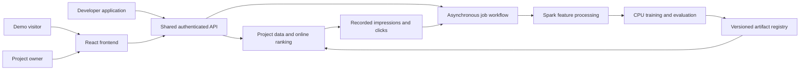

# Phase 7 — AWS recommendation platform

**Status:** Planned; documentation checkpoint only. No Phase 7 application, infrastructure, cloud deployment, or production results are implemented by this plan. Phases 0–6 remain the reproducible research foundation.

**Planning date:** November 2, 2026. **Deployment constraint:** a student portfolio project with a target of **less than $10 total AWS spend**, one short recording session, then teardown. This replaces the earlier suggestion of an always-running ECS/RDS deployment.

## 1. The next phase

Turn the existing distributed recommendation research project into a small, complete recommendation platform. A customer should create a project, upload supported item and interaction data, validate it, build features, train a model, inspect its evaluation, deploy a selected version, and request recommendations. A public video demo should exercise the same recommendation path as a developer integrating the API.

The engineering goal is production-oriented software: explicit contracts, identity and authorization, isolated project data, asynchronous jobs, reproducible artifacts, honest failure states, automated verification, observable requests, and a repeatable deployment and teardown. The cloud demonstration will be deliberately small and temporary. It will not establish production traffic capacity, an availability SLA, real customer adoption, or a measured improvement in user engagement.

The portfolio should make that distinction easy to see. A short recording demonstrates the deployed workflow; the repository supplies the architecture, source, tests, manifests, measured results, decisions, and cleanup evidence behind it. A recruiter can understand the product, while an engineering lead can inspect how it behaves under failure.

## 2. Reading order

| Document | Purpose |
|---|---|
| [This phase brief](README.md) | Product scope, current baseline, decisions, and definition of completion |
| [Checkpoints](checkpoints.md) | Ordered implementation tasks, deliverables, validation, and exit criteria |
| [AWS architecture](architecture.md) | Service boundaries, authorization, asynchronous execution, deployment, and tradeoffs |
| [Data and ML contracts](data-and-ml-contracts.md) | Upload schemas, feature parity, training, evaluation, ranking, and model lifecycle |
| [Frontend and demo](frontend-and-demo.md) | React application, customer journeys, design, accessibility, and browser verification |
| [Budget, recording, and teardown](budget-and-recording.md) | Usage envelope, cost worksheet, rehearsal, evidence capture, and resource removal |

Checkpoint numbers and completion states are maintained in [checkpoints.md](checkpoints.md). Supporting documents describe the target behavior; they do not independently mark work complete.

## 3. One platform, three experiences

| Experience | User | Complete journey |
|---|---|---|
| Public demonstration | Recruiter, reviewer, or visitor during the recording session | Open the feed, choose a demo profile, obtain recommendations, inspect the serving version or fallback, and see a real interaction recorded |
| Developer API | Application developer | Obtain a scoped credential, submit items/events, request recommendations, handle errors, and inspect a request ID and model version |
| Customer dashboard | Project owner | Sign in, create a project, upload the documented dataset, view validation and job states, inspect metrics, deploy or roll back a version, and manage credentials |

The demo is an isolated project using the shared API and ranking engine. It does not get a second recommendation implementation or unrestricted access to customer projects. Its browser never receives a credential that can upload datasets, start training, or deploy models.

The self-service workflow is intentionally limited to an owner-controlled test account during the AWS session. Public self-registration, unlimited anonymous training, payments, and real customer onboarding are outside this phase. Two test projects still demonstrate authorization and data isolation.

## 4. What exists and what changes

| Area | Existing evidence | Phase 7 work |
|---|---|---|
| Distributed data processing | HDFS/Spark raw → bronze → silver → features → gold, quality checks, leakage tests, benchmarks | Add a project-specific canonical data adapter and bounded S3/EMR execution; keep the existing KuaiRand path reproducible |
| Model training | CPU PyTorch LR/DeepFM, feature specifications, saved checkpoints, held-out evaluation | Train a platform model on its own compatible item/event schema; produce immutable, deployable model bundles |
| Inference | Frozen-model panel scoring three historical profiles | Implement request-time candidate selection, feature assembly, model scoring, version routing, and a disclosed baseline |
| Feed | Responsive local preview and attributed playable media | Move to React/TypeScript, persist project-scoped activity through the API, and connect the feed to the platform ranker |
| Persistence | Local Parquet, SQLite catalog, browser-local likes/follows | S3 durable objects and DynamoDB on-demand project metadata, items, events, and bounded online feature snapshots |
| Operations | Local scripts and tests | Infrastructure as code, repeatable packaging, CI, cloud logs, bounded execution, recording, and verified teardown |

Current boundaries are documented in [the frontend guide](../../frontend/README.md) and [the historical inference contract](../../serving/README.md). In particular, the KuaiRand model's item IDs do not identify Commons or bundled demo videos. Hosting that preview alone does not produce a personalized feed.

## 5. First-release scope

### Included

- One account/project model with owner and read-only access boundaries; every resource belongs to a project.
- A documented v1 item/impression/click data contract, small seeded fixtures, and explicit validation errors.
- Upload → validate → Spark feature build → CPU training → evaluate → register → explicit deploy.
- One DeepFM model family with an appropriate baseline and fixed, allowlisted training settings.
- A versioned HTTP API with structured errors, pagination, idempotency, bounded requests, and an OpenAPI contract.
- Real candidate ranking and cold-start behavior on the demo's own item IDs and data.
- A professional React dashboard and responsive public demonstration, including loading, empty, denied, failed, and unavailable states.
- An AWS serverless deployment, one short cloud verification/recording session, and a reusable teardown procedure.
- A portfolio evidence package that survives cloud deletion.

### Deferred

Arbitrary uploaded Python/model executables, arbitrary CSV schemas, custom model architectures, large-scale candidate search, GPUs, real-time streaming retraining, a marketplace, billing, paid domains, multi-region availability, Kubernetes, Kafka/MSK, managed feature stores, and commercial readiness claims. Larger deployments can evolve from measured bottlenecks; they are not prerequisites for this portfolio outcome.

## 6. Selected implementation direction

| Layer | Decision | Reason |
|---|---|---|
| Frontend | React + TypeScript + Vite | Typed screens and reusable components for a dashboard plus feed; static assets can be deployed cheaply |
| API | Node.js + TypeScript, modular domain code with Lambda/HTTP and local-server adapters | Builds on the existing Node serving experience; local rehearsal and cloud routes share business logic |
| ML | Python + existing PyTorch code, trusted CPU container | Reuses demonstrated training skills and provides real predictions without adding a GPU requirement |
| Online persistence | DynamoDB on-demand | Avoids an idle relational database for the single-session deployment; requires documented access patterns and conditional writes |
| Files | Private S3 objects with explicit manifests | Keeps raw data, processed partitions, and model bundles outside source control |
| HTTP/auth | API Gateway HTTP API, Cognito dashboard identity, application-managed scoped API keys | Separates customer identity from server-to-server integration credentials |
| Compute | Lambda APIs/ranking/small training; bounded EMR Serverless Spark job | Keeps idle application compute out of the primary topology |
| Workflow | Step Functions Standard plus durable job records | Shows actual asynchronous job state and handles failures without holding a browser request open |
| Delivery | Terraform, local image builds, ECR, GitHub Actions with OIDC | Reviewable infrastructure and short-lived deployment credentials |

These are planning decisions, not installed dependencies or completed migrations. Runtime versions, regional quotas, Lambda image size, cold starts, and exact rates must pass checkpoint gates before cloud use. The [architecture](architecture.md) explains the supported boundaries; the [budget runbook](budget-and-recording.md) gives the workload envelope. Larger CPU training can move to one-shot ECS tasks in a future budgeted deployment; it is not silently provisioned if a Lambda trial fails.



Events become input to a later explicit dataset build; a click does not retrain the model synchronously. The diagram is a logical design, not a statement that these components are deployed.

## 7. Build sequence and working method

The detailed plan has twelve checkpoints. Build the local vertical slice first, including the failed paths, before creating AWS resources. Keep the existing research workflow usable throughout the migration.

1. Freeze the contracts and produce a tiny, licensed/seeded demo dataset.
2. Establish typed API modules, local adapters, and automated checks.
3. Add identity, project authorization, and scoped credentials.
4. Implement upload/validation and durable job states.
5. Port the platform Spark transformations to S3-compatible execution.
6. Package bounded training, evaluation, and immutable model bundles.
7. Serve real recommendations with a known baseline and versioned deployment.
8. Build the customer dashboard on those contracts.
9. Connect the public demo and record attributable interaction events.
10. Finish Terraform, CI, cost controls, and local deployment rehearsal.
11. Deploy the small AWS session, verify it, and record all three journeys.
12. Export evidence, delete resources, inspect residual resources/billing, and finish the portfolio story.

Each checkpoint should normally be one small branch/PR with its own problem statement, implementation, meaningful checks, evidence, and exit result. Split a checkpoint into smaller PRs when needed; never treat a partially working multi-week change as one review unit. A checkpoint is complete only when its acceptance criteria pass and the evidence is linked. Documentation states planned, in progress, measured, or complete explicitly.

Suggested future layout, to be introduced incrementally:

```text
apps/web/                 React feed, dashboard, and developer experience
services/api/             TypeScript domain modules and local/Lambda adapters
services/ranker/          Python request-time feature assembly and scoring
jobs/                     Validation, platform Spark entry point, training wrappers
contracts/                OpenAPI, JSON schemas, fixtures, and shared identifiers
infra/terraform/          One disposable AWS environment and outputs
scripts/platform/         Local rehearsal, evidence export, deployment, and teardown
docs/phase-7/             This plan, decisions, and checkpoint records
docs/evidence/phase-7/    Small reviewed screenshots and sanitized result summaries
```

Do not move existing files merely to match a tree. Extract reusable behavior with compatibility tests, then update entry points deliberately. Keep bulk data, checkpoints, Terraform state, secrets, and raw logs out of Git. Audit ignore rules as new directories are added.

## 8. Completion means demonstrated behavior

The final recording and reproducible evidence must show:

- Owner A creates a project; Owner B cannot access its data, jobs, keys, or models.
- A malformed upload produces actionable validation errors and never starts expensive processing.
- A valid, small dataset runs through real processing/training; the dashboard displays persisted states and measured results.
- Model registration does not implicitly deploy; a selected compatible version is activated, returned in requests, and can be rolled back.
- A developer obtains recommendations using a scoped test key; invalid or revoked credentials fail.
- The feed uses the same ranker; unknown users/items have a documented fallback, and displayed item IDs match the model's catalog.
- At least one failed/retried job and one unavailable-inference path are demonstrated locally, with representative cloud verification where affordable.
- Teardown removes the environment and the repository retains the architecture, recording link, result summaries, and cleanup record.

Latency, training duration, cold-start behavior, cost, and error counts are measured and labeled with the environment, workload, sample size, and date. Small-sample p95 values are descriptive; they do not establish an SLA. Use the recorded workload to explain engineering tradeoffs, not to imply production load testing.

## 9. Portfolio presentation

| Reader | What they should understand quickly | Evidence |
|---|---|---|
| Recruiter/HR | What the platform does, what was built, and which skills it demonstrates | Product screenshot, a short recording, concise feature overview, and stack summary |
| Backend/platform lead | Isolation, durable state transitions, API contracts, deployment, failure handling, and cost tradeoffs | Architecture, ADRs, OpenAPI, authorization/idempotency tests, workflow/log evidence, teardown record |
| ML/data lead | Point-in-time features, credible labels, reproducibility, baselines, and controlled promotion | Data contract, parity/leakage checks, manifests, evaluation report, and model-version evidence |
| Frontend lead | Coherent navigation, actual asynchronous behavior, accessibility, and robust states | Screen walkthrough, responsive screenshots, and browser checks against the real local API |

Describe a synthetic fixture as synthetic. Preserve original KuaiRand benchmark results as separate research evidence. Do not invent customers, traffic, business lift, uptime, savings, or model superiority. After teardown, put a visible note beside the recording: when it ran, what data it used, and that the AWS environment was intentionally removed after capture.

## 10. Decisions and open details

Confirmed by the user: all three experiences, AWS backend, frontend stack chosen for fit, student budget under $10 total, recording once, GitHub evidence, and teardown afterward.

Planning defaults: `us-east-1` for initial pricing comparison; an owner-controlled Cognito account plus a second isolation-test account; synthetic interaction fixtures joined to a small attributed catalog; no domain purchase; and a maximum four-hour cloud session. These are configurable assumptions, not existing AWS account settings.

Before the cloud checkpoint, identify the intended AWS account/region, verify quotas and current prices, and choose the recording destination. Those details do not block local implementation. The user has requested this documentation; provisioning paid AWS resources and publishing new artifacts are separate implementation actions, not performed by writing this plan.

## 11. Phase status

- [x] Document the product, architecture, contracts, checkpoint plan, and budget/recording approach.
- [ ] Complete checkpoints 7.1–7.10 locally and prepare the cloud run.
- [ ] Complete the recorded AWS proof in checkpoint 7.11.
- [ ] Complete teardown and portfolio evidence in checkpoint 7.12.

The phase remains **planned** until implementation begins. Planning documents are not evidence that the platform already exists.
