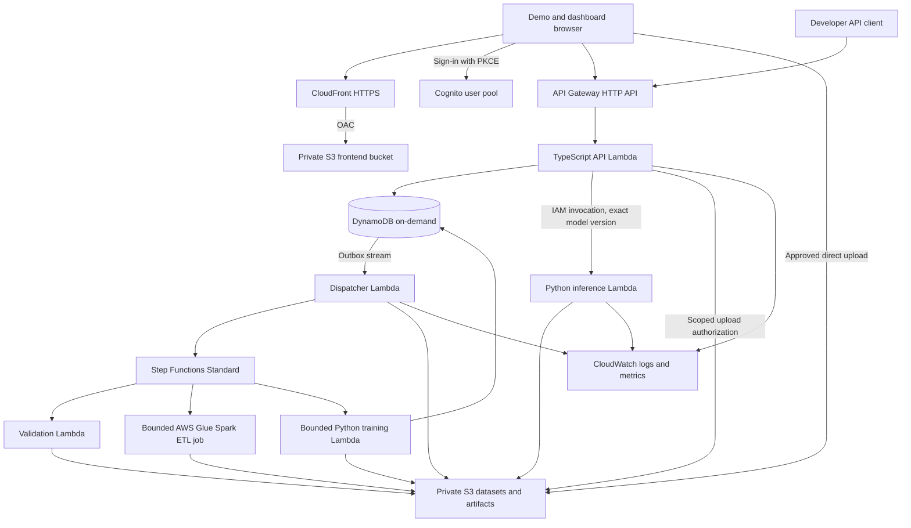

# Phase 7 — AWS architecture and backend design

**Status: proposed; nothing in this document is deployed.** This phase targets a short-lived recent-graduate portfolio demonstration, one screen recording, and teardown, with total **gross AWS usage intended to remain below $10 before credits**. The user reports a new AWS **Free plan** account with **$100 in credits**. That balance, expiry, and service eligibility have not been verified against the account; the available credit is not the project budget. Keep the $5 planned-usage allowance and $9 allocation including reserve in the budget runbook. No AWS API calls, resource creation, or plan upgrade are performed by this documentation.

AWS capabilities were checked against official documentation on November 2, 2026. Read [the phase brief](README.md), [checkpoints](checkpoints.md), [data/model contracts](data-and-ml-contracts.md), and the controlling [budget and recording plan](budget-and-recording.md) alongside this design. The planning Region is `us-east-1`; verify availability, current prices, and the selected account before any deployment.

## 1. What will change

The existing [Node server](../../frontend/server.mjs) is a loopback-only preview with a local SQLite catalog and a child-process bridge to Python. The [DeepFM panel](../../serving/README.md) scores recorded training examples; it does not rank the playable feed. Spark currently runs through Docker/HDFS scripts, and training reads a local gold export.

Phase 7 will preserve tested transformations, training models, feature specifications, artifact verification, catalog attribution, and useful UI behavior. It will add shared application contracts for three experiences: a public demonstration, an authenticated developer API, and a customer-style dashboard for upload, training, evaluation, and deployment. Demonstration accounts and supported datasets will be bounded fixtures, not unrestricted public paid-compute access.

The TypeScript backend will be a modular application, divided into project authorization, catalog/events, uploads, jobs, model registry, deployments, and developer credentials. Modules can share Lambda handlers where practical. Python will remain the model runtime. Replacing the local preview server does not require a large microservice estate.

## 2. Primary service choices

| Component | Planned implementation | Reason for this phase |
|---|---|---|
| Frontend | React, TypeScript, Vite; private S3 bucket and CloudFront OAC | Static build, three coherent user journeys, no frontend server |
| Public HTTP boundary | API Gateway HTTP API | HTTPS and Cognito JWT integration without an always-on ALB |
| Application API | Node.js/TypeScript Lambda functions | Reusable domain modules with on-demand invocation |
| Identity | Cognito user pool; seeded demonstration users | Human login and membership checks; no paid SMS flow |
| Project/catalog/event state | DynamoDB on-demand tables | Bounded data with no permanently running database instance |
| Datasets/model artifacts | Private S3 objects plus immutable manifests | Durable versioned inputs and reproducible outputs |
| Event/job dispatch | DynamoDB transactional outbox and Streams-triggered Lambda | Retryable asynchronous work without an always-running worker |
| Workflow | Step Functions Standard | Traceable preprocessing/training steps and explicit failure states |
| Spark | AWS Glue Spark ETL, one bounded job | Proposed Free-plan-compatible distributed processing with no idle session |
| CPU training/inference | Separate Python Lambda functions using the same trusted container image | Small model/fixture, bounded duration, no persistent model endpoint |
| Delivery/evidence | Terraform, local image build, ECR, GitHub Actions OIDC, CloudWatch | Reproducible deployment and retained engineering proof |

HTTP APIs do not provide native API keys, usage plans, or per-client throttling. Developer keys and per-project limits will therefore be application-managed. JWT authorization is available for dashboard routes. These are deliberate design choices, not capabilities to assume from REST API tutorials. [AWS HTTP/REST comparison](https://docs.aws.amazon.com/apigateway/latest/developerguide/http-api-vs-rest.html).

AWS lists Glue in the Free Tier of its new sign-up experience without a Glue-specific exclusion, and the published Free Tier project policy includes the `glue:*` service namespace. This supports Glue as the proposed cloud Spark path; it is not proof that a particular account/Region can launch this job. Check the actual plan, permissions, quotas, and credit eligibility before deployment. Glue ETL compute consumes metered usage; the Data Catalog's free metadata allowance does not make Spark jobs free. [Supported services](https://docs.aws.amazon.com/accounts/latest/reference/supported-services-sign-up-new.html), [published project policies](https://docs.aws.amazon.com/accounts/latest/reference/scps-and-rcps-for-projects.html).

No VPC connection, NAT gateway, ALB, RDS, Fargate service, EKS, managed Kafka, Redis, provisioned concurrency, custom domain, or cloud image-build service belongs in the primary deployment. The initial Glue job reads and writes approved same-Region S3 paths with its job role, using no VPC data-store connection. It does not need HDFS, a crawler, an interactive notebook/session, or a Data Catalog metastore to process these explicit Parquet paths. [Glue Spark job properties](https://docs.aws.amazon.com/glue/latest/dg/add-job.html).

### Proposed API surface

Freeze exact names and schemas in checkpoint 7.1, then generate the frontend client from the versioned OpenAPI contract. The following is a starting contract, not a list of existing endpoints.

| Route family | Planned operations | Authorization |
|---|---|---|
| `/v1/projects` | Create/list projects; retrieve authorized project configuration | Dashboard JWT and membership |
| `/v1/projects/{project_id}/datasets` | Create upload identity, finalize upload, inspect validation and immutable dataset versions | Project owner |
| `/v1/projects/{project_id}/training-jobs` | Start, list, inspect, and request cancellation of bounded jobs | Project owner; session job quota |
| `/v1/projects/{project_id}/models` | Inspect registered versions, lineage, evaluation, and eligibility | Authorized project member |
| `/v1/projects/{project_id}/deployments` | Inspect active generation; explicitly promote or roll back an eligible version | Project owner for mutations |
| `/v1/projects/{project_id}/api-keys` | Issue scoped key once, list masked summaries, revoke | Project owner |
| `/v1/projects/{project_id}/items` | Upsert a bounded item batch and retrieve available project items | Authorized member or item-write integration scope |
| `/v1/projects/{project_id}/events` | Accept bounded impression/click/watch events with deduplication | Authorized member or event-write integration scope |
| `/v1/projects/{project_id}/recommendations` | Request up to 20 results from at most 200 candidates | Authorized member or recommendation-read integration scope |
| `/v1/demo/*` | Fixed-project recommendations and narrow session event submission | Restricted public-demo policy; no caller-selected project |
| `/health` | Minimal service health; model readiness is separate and version-specific | Public response contains no internal configuration |

Long-running requests return `202` with a durable resource ID and status URL. List APIs use opaque cursors and bounded page sizes. Errors use a stable envelope containing `code`, safe `message`, `request_id`, and permitted field details. Define `400` malformed input, `401` invalid identity, `403` denied action, `404` inaccessible/missing resource according to the disclosure policy, `409` conflicting identity/state, `413` payload limit, `429` quota/throttle, and `503` unavailable serving. Preserve one policy consistently rather than leaking resource existence through inconsistent responses.

Owner mutations that create expensive work require a retained idempotency key and canonical payload digest. Audit actor/project/resource/transition without raw credentials or datasets. Neither a developer key nor a public-demo route grants the ability to start training merely because it can submit events.

## 3. Intended short-lived topology



The frontend and API may use their default AWS HTTPS hostnames. Configure API CORS for the exact frontend origin and forward no credentials to media sources. Customer data and model buckets are not public or frontend static origins. The frontend bucket will allow CloudFront access through OAC, with direct object access denied. [CloudFront private-origin design](https://docs.aws.amazon.com/AmazonCloudFront/latest/DeveloperGuide/private-content-overview.html).

The ranker and training functions will have no public function URL. Invocation will require the appropriate API/workflow IAM role. The browser will not select a function ARN, role, S3 key, checkpoint path, or training command.

## 4. Identity and project boundaries

Dashboard users will use Cognito authorization-code login with PKCE. Gateway JWT validation and backend project membership are separate checks. Validate issuer, client identity, expiry, token use, scopes, and signature; a decoded token is not a verified token. Use short sessions and document logout/revocation limitations. [Cognito token verification](https://docs.aws.amazon.com/cognito/latest/developerguide/amazon-cognito-user-pools-using-tokens-verifying-a-jwt.html).

Developer keys will be high-entropy, project-bound, scoped, and revocable. Store only a key identifier and cryptographic digest plus permissions and metadata; reveal the full key once. Authorize them in the application or a narrowly configured Lambda authorizer, with no revocation-obscuring cache. Do not expose privileged keys in frontend assets. Public demo routes will assign a fixed demonstration project server-side and will not permit training or customer-project access.

Every DynamoDB key/query, object lookup, model selection, and job must carry an authorized project context. Derive that context from verified membership/key ownership, not an untrusted body field. Use project-prefixed partition keys and conditional checks for related objects; query supported indexes rather than scanning all customer data. Demonstrate cross-project access failures locally with two projects before the AWS run.

Logical isolation in shared tables/functions is not account-per-customer isolation. Application roles will separate API, dispatch, validation, preprocessing, training, and inference permissions. Server-selected S3 prefixes and allowlisted resource ARNs are mandatory. A shared execution role's residual access is a documented limitation, not evidence of IAM-enforced isolation between every customer.

## 5. Online ranking and asynchronous events

For a recommendation request, the API will authenticate, enforce the project limits, resolve the active deployment generation, fetch at most **200 candidates**, and build bounded current-context features. It will invoke the ranker with an exact model/encoder/feature version and return ordered catalog IDs, request identity, model identity, and an explicit fallback reason when a baseline was used. No recommendation request may start Spark or train a model.

DynamoDB will store the small demonstration catalog, recent user history, online summaries, and deployment pointers. Cold-start users and sparse-data projects will have a documented deterministic baseline. A timeout cannot silently become an invented DeepFM score. The feature and impression semantics are defined in [the data contract](data-and-ml-contracts.md).

Event acceptance will conditionally write the unique `(project_id, event_id)` and pending outbox item in a `TransactWriteItems` operation. Duplicate IDs with the same payload return the existing result; conflicting payloads fail. Durable unique keys remain necessary because provider idempotency tokens have a bounded window. AWS supports atomic multi-item transactions and documents that its client token window is ten minutes. [DynamoDB transactions](https://docs.aws.amazon.com/amazondynamodb/latest/developerguide/transaction-apis.html).

The Streams handler will process only applicable pending outbox records, use event IDs to deduplicate summary updates, write stable S3 export identities, and then conditionally mark work complete. It will not assume records from one transaction arrive together. Retries must not double-count events or launch a second logical job. DynamoDB Streams consumers can receive records more than once. [Stream consumer semantics](https://docs.aws.amazon.com/amazondynamodb/latest/developerguide/Streams.Lambda.BestPracticesWithDynamoDB.html).

Configure bounded retry/record age and persist failure evidence to private S3. Pending outbox records remain replayable by an operator command; stream retention is not the durable job ledger. A small, explicit SQS retry queue is a future option if the tested handler needs it, not an automatic extra dependency. Stream filters must prevent the handler's own status updates from recursively creating work.

## 6. Bounded upload-to-model workflow

The API will allocate a project/dataset version and short-lived constrained upload authorization. Upload completion will verify size, checksum, object ownership, and approved format. The first version accepts one documented items/events schema, not arbitrary code, arbitrary model uploads, or unbounded datasets.

A training request will transactionally create a job row and outbox item. Dispatch uses a deterministic Step Functions execution name and canonical input. On uncertain launch results, reconcile the existing execution rather than allocate a new name. Standard executions reuse a running execution for matching name/input; a closed execution with that name causes `ExecutionAlreadyExists`, which must be reconciled as existing work. [StartExecution behavior](https://docs.aws.amazon.com/step-functions/latest/apireference/API_StartExecution.html).

```text
validate approved package -> canonicalize -> Spark preprocessing/quality gates
 -> completed gold/feature manifest -> bounded CPU training
 -> frozen candidate evaluation -> register immutable candidate
```

Promotion will remain a separate explicit operation. Step Functions Standard will use `arn:aws:states:::glue:startJobRun.sync` and synchronous Lambda invocation, rather than wait for processing/training in an HTTP request. Its role needs the applicable `glue:StartJobRun`, `GetJobRun`, `GetJobRuns`, and `BatchStopJobRun` permissions; review generated permissions and restrict job selection to the server-owned definition. The Glue job role separately needs its approved S3/log access. [Glue integration and IAM actions](https://docs.aws.amazon.com/step-functions/latest/dg/connect-glue.html), [Lambda integration](https://docs.aws.amazon.com/step-functions/latest/dg/connect-lambda.html).

Transient retries must be limited and budgeted. Invalid datasets and failed quality checks are terminal until input changes. Failure/cancellation paths will update durable job state and cancel active child work; stopping a workflow alone is not sufficient evidence that every resource stopped. A reconciliation command will compare job rows and provider execution states before recording and teardown.

### Demonstration resource envelope

| Work | Initial planned bound, to prove before deployment |
|---|---|
| Ranker | Candidate memory 2 GiB; model artifact at most 10 MiB; at most 200 candidates/request; no provisioned concurrency |
| Training | Candidate memory 4 GiB; 600-second function timeout; approved fixture at most 50 MiB; 3–5 epochs; one run |
| Glue runtime | Candidate pinned `GlueVersion=5.0`, `Command.Name=glueetl`: Spark 3.5.4, Python 3.11, Java 17 |
| Glue workers | `WorkerType=G.1X`, `NumberOfWorkers=2`: 2 DPU, nominally 8 vCPU / 32 GB total; no autoscaling |
| Glue run controls | `ExecutionClass=STANDARD`, `Timeout=15` minutes, `MaxRetries=0`, `MaxConcurrentRuns=1`, `JobRunQueuingEnabled=false` |
| Spark job count | One entry point executes all platform stages in one Glue job; no crawler, notebook, interactive session, or second automatic run |
| Hosted session | Target at most four hours from first resource creation to stop/teardown start; verify deletion afterwards, including propagation delays |

These are release bounds, not measurements already achieved. Glue manages its worker layout; the former 2-vCPU/4-GB application profile does not apply. Two G.1X workers provide the proposed minimum 2-DPU batch job. The fractional G.025X worker is for streaming and is not a cheaper substitute for this Spark ETL job. Explicitly set workers, timeout, and zero automatic retries rather than accept larger/default settings. Pin the release and run compatibility tests: the existing local Spark 3.5.9/Python 3.10 environment is not an exact match for Glue 5.0. [Glue runtime versions](https://docs.aws.amazon.com/glue/latest/dg/release-notes.html), [worker/job configuration](https://docs.aws.amazon.com/glue/latest/dg/aws-glue-api-jobs-job.html).

The trusted Python image will contain CPU-only dependencies and the required Lambda runtime interface. Training will download only approved gold shards into bounded `/tmp` space and upload results to S3; it cannot rely on persistent local files. Lambda supports container images, but that alone does not establish PyTorch startup speed or training feasibility. [Lambda container requirements](https://docs.aws.amazon.com/lambda/latest/dg/images-create.html).

Package the single Glue entry point, shared application modules, and pinned Python wheels in approved S3 objects. Rehearse with compatible Spark/Python dependencies in local development/CI; avoid resolving changing public packages during the metered cloud run. Glue supports additional Python files and prebuilt wheel artifacts. Parse Glue's runtime arguments deliberately and reuse one Spark session across stages; do not invoke the HDFS/Docker shell wrapper. [Glue Python dependency packaging](https://docs.aws.amazon.com/glue/latest/dg/aws-glue-programming-python-libraries.html).

If local training cannot finish within the configured envelope, reduce the approved fixture and document the limitation. Do not silently provision Fargate/GPU capacity or rerun expensive jobs. A larger runtime would require a new design and cost estimate outside this phase's deployment profile.

## 7. S3 publication and model routing

Use immutable project-scoped object keys:

```text
projects/<project_id>/datasets/<dataset_version>/raw/...
projects/<project_id>/runs/<run_id>/bronze|silver|features|gold/...
projects/<project_id>/models/<model_version>/...
projects/<project_id>/events/<export_batch_id>/...
```

Completed manifests will identify exact objects/versions, checksums, schemas, inputs, code digest, configuration, and feature version. Write complete immutable objects and their manifest first; conditionally register their identity in DynamoDB afterwards. Consumers read registered completed manifests. Reconcile an object upload that succeeds before its metadata write fails.

Do not port local temporary-directory swaps as S3 transactions. S3 provides strong object read-after-write consistency and atomic replacement of one key; a multi-object dataset needs the application's publish protocol. General-purpose object rename uses copy/delete. [S3 consistency](https://docs.aws.amazon.com/AmazonS3/latest/userguide/Welcome.html), [copy/rename behavior](https://docs.aws.amazon.com/AmazonS3/latest/userguide/copy-object.html).

The model registry will distinguish registered, validated, warm-checked, active, and retired identities. Promotion will verify artifact/feature compatibility, invoke a scoring probe for the exact version, then conditionally update the project's deployment generation. Each request pins that generation/version; a warm Lambda environment may cache only a checksum-verified matching artifact and must reload or reject a different requested version.

**A warmup call does not keep Lambda warm or warm every execution environment.** New environments still load and verify the exact requested version. Keep the previous approved manifest for rollback; in-flight requests keep their pinned version. Test promotion, stale caches, concurrent requests, and rollback locally. Do not describe one recorded Lambda invocation as a fleet-wide zero-downtime deployment proof.

The HTTP API integration has a **30-second maximum timeout**. Cold image initialization, artifact loading, API overhead, and inference must fit below that limit. Measure cold and warm paths separately, and enforce a shorter internal deadline with a clearly reported baseline/unavailable result. A failed cold-start gate must be resolved before the AWS recording; increasing the Lambda function timeout cannot extend HTTP API's limit. [HTTP API quotas](https://docs.aws.amazon.com/apigateway/latest/developerguide/http-api-quotas.html).

## 8. Delivery, observability, and teardown

Terraform will define one ephemeral environment, tagged with project/run identity. Use local development and local integration tests for repeated iteration; do not maintain idle staging/production environments. Build the CPU image locally, pin digests, and run Lambda-compatible tests before uploading. GitHub Actions may use a tightly repository/environment-scoped OIDC role, but public-fork PRs must not receive deployment credentials. [AWS GitHub OIDC controls](https://docs.aws.amazon.com/IAM/latest/UserGuide/id_roles_create_for-idp_oidc.html).

Use separate least-privilege function roles, short-lived operator credentials, encrypted private storage, and configuration outside source control. This profile does not need a permanently paid secret service for app-managed key digests. Never publish credentials, presigned URLs, customer payloads, or raw personal identifiers in logs, screenshots, Terraform state, or recordings.

CloudWatch evidence will cover cold/warm API latency, errors, fallback rate, dispatch lag, workflow state, resource duration, model version, and successful teardown. Keep access logs bounded and redact tokens/features. Record the actual fixture size, candidate count, model size, function memory/duration, Glue job/worker configuration and observed run duration, and timestamps alongside metrics; a small fixture cannot establish large-scale throughput or model quality. Keep gross metered usage, applied credits, remaining reported credit, and any out-of-pocket amount separate in the cost report.

Before public requests, apply low gateway route limits, application project/job quotas, small Lambda concurrency limits where the account permits them, and allowlisted training permissions. No unrestricted sign-up or anonymous training route belongs in this recording. AWS Budgets notifications are not a real-time spending circuit breaker, and application/gateway throttles are not dollar-accurate controls. Some new-experience projects offer separate managed spend limits; verify whether the actual account has them and their behavior before claiming enforcement. Neither the $100 reported credit nor an optional spend-limit feature replaces the supervised under-$10 usage plan. Use [budget-and-recording.md](budget-and-recording.md) for the cost ledger, reserve, stop conditions, and exact recording sequence.

After recording, export sanitized screenshots, API responses, workflow history, metrics, and checksums locally. Then stop active executions/jobs, explicitly inspect/cancel Glue runs, and wait for in-flight Lambda work to finish or time out before deleting its inputs/outputs. Delete the ephemeral stack and verify CloudFront, API/Lambda, DynamoDB/Streams, Glue job definitions and associated storage/logs, Cognito, S3 versions/uploads, and ECR images are gone or explicitly accounted for. A successful Terraform command alone is insufficient cleanup evidence. Retain the recording, source, architecture, measured results, and teardown report in the portfolio; do not leave billable resources serving a link that nobody needs.

## 9. Larger production direction — not deployed in this phase

The earlier EMR Serverless candidate is deferred because AWS places Amazon EMR in the Paid Plan list for its new sign-up experience, while Glue is listed for the Free Tier. The actual account still needs eligibility verification. This plan does not authorize upgrading to Paid or activating advanced features; if the proposed Glue job is unavailable, stop and revisit the design. A local Spark replay must be labeled local and cannot silently close the cloud Spark/self-service acceptance gate. [Account service availability](https://docs.aws.amazon.com/accounts/latest/reference/supported-services-sign-up-new.html), [Free/Paid project policies](https://docs.aws.amazon.com/accounts/latest/reference/scps-and-rcps-for-projects.html).

For sustained customer use, reconsider dedicated CPU inference on ECS/Fargate or SageMaker after measuring model count, latency, and traffic. A larger design may use a database suited to catalog/query requirements, durable queue workers, separate staging, multi-AZ networking, tested backups, and stronger tenant IAM boundaries. Stateful API/inference replicas would need version-specific readiness and rollout coordination beyond Lambda's per-invocation version checks.

An ALB/RDS/NAT/Fargate topology has recurring costs and is intentionally outside the one-recording budget. Larger resilience goals require load/failure testing and a separately approved cost model. The recruiter-facing description should say **production-oriented, authenticated, reproducible AWS demonstration**, followed by the measured evidence and deployment lifetime, rather than imply a continuously operated production SaaS.
